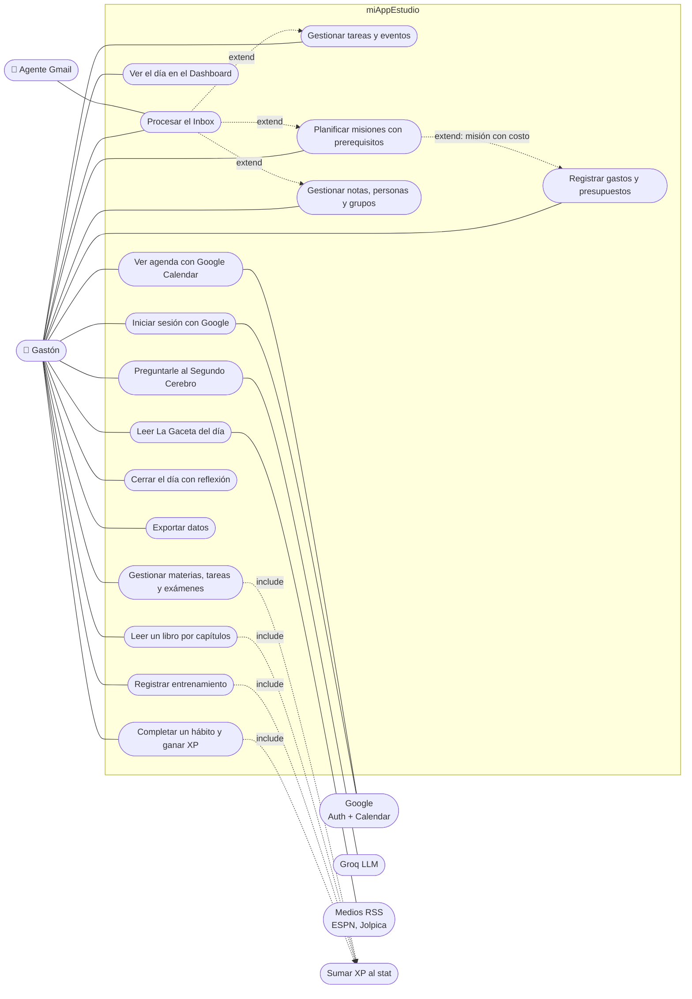

# Casos de uso

> Diagrama ⑦. Mermaid no tiene diagrama UML de casos de uso: se dibuja con un flowchart (actores a los costados, casos de uso dentro del límite del sistema).

## Diagrama

## Detalle

| ID | Caso de uso | Actor | Disparador | Resultado | Pantalla |
|---|---|---|---|---|---|
| UC1 | Iniciar sesión | Gastón, Google | abrir la app sin sesión | sesión + datos cargados | `LoginScreen` |
| UC2 | Ver el día | Gastón | abrir la app | hábitos, agenda, misiones y rocas de hoy | `dashboard` |
| UC3 | Completar hábito | Gastón | tocar un hábito activo | `completedDates` + XP × racha | `habits`, `dashboard` |
| UC4 | Tareas y eventos | Gastón | botón "+" en Calendario | tarea con recurrencia o evento | `calendar` |
| UC5 | Google Calendar | Gastón, Google | Ajustes → Conectar | eventos de Google junto a los propios | `settings`, `calendar` |
| UC6 | Entrenamiento | Gastón | marcar ejercicio / series | +5 XP Fuerza, `setsLog` | `gym` |
| UC7 | Libro por capítulos | Gastón | marcar capítulo leído | +`xpPorCapitulo` Inteligencia | `attributes` → Biblioteca |
| UC8 | Facultad | Gastón | completar tarea o cargar nota | +15 XP o `nota/notaMax × 30` | `attributes` → Facultad |
| UC9 | Misiones | Gastón | crear / completar misión | árbol actualizado; bloqueo por prerequisitos | `missions` |
| UC10 | Billetera | Gastón | cargar movimiento | transacción, presupuesto, meta | `billetera` |
| UC11 | La Gaceta | Gastón, Medios | abrir Diario | edición de hoy rankeada por gustos | `diario` |
| UC12 | Procesar Inbox | Gastón, Agente | ítem nuevo en Inbox | ítem convertido en nota, tarea, misión… | `cerebro` → Inbox |
| UC13 | Notas y personas | Gastón | crear / editar | notas PARA, personas con pendientes y fechas | `cerebro` |
| UC14 | Chat | Gastón, Groq | escribir pregunta | respuesta con contexto propio | `cerebro` → Chat |
| UC15 | Cierre del día | Gastón | después de las 21:00 | reflexión guardada como nota | modal `CierreDia` |
| UC16 | Exportar | Gastón | Ajustes → Exportar | JSON descargado (hoy: solo 5 colecciones) | `settings` |

Criterios de aceptación de cada uno: [criterios-aceptacion.md](../06-calidad/criterios-aceptacion.md).
