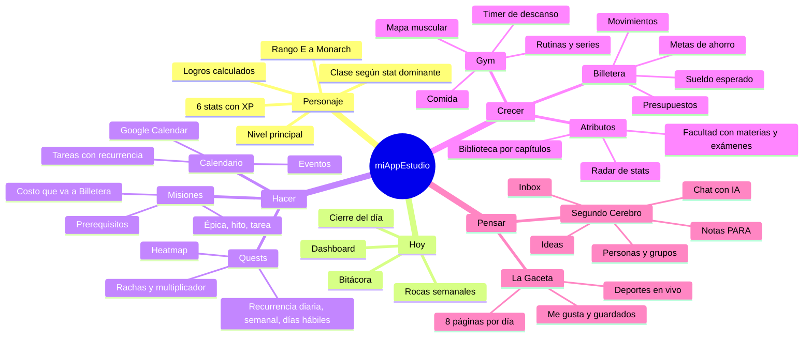
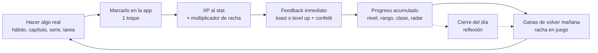

# Mapa de producto

> Diagrama ⑧, parte producto. Qué tiene la app y cómo se conectan las partes. La parte de experiencia está en [journeys.md](../02-ux/journeys.md).

## Mapa de módulos

## El loop central

Lo que hace que la app funcione como juego: cada acción vuelve como progreso visible.

## Fuentes de XP (hoy)

| Fuente | Stat | XP | Código |
|---|---|---|---|
| Hábito | el del hábito | `xpValue` (20 por defecto) × 1 / 1,25 / 1,5 / 2 según racha | `App.tsx:597-600` |
| Ejercicio | Fuerza | ±5 | `App.tsx:979` |
| Capítulo | Inteligencia | ± `xpPorCapitulo` | `App.tsx:1218` |
| Tarea de facultad | Inteligencia | ±15 | `App.tsx:1328` |
| Examen con nota | Inteligencia | `round(nota / notaMax × 30)` | `App.tsx:1358-1363` |
| Misión | — | 0 (solo confetti) | `App.tsx:740-743` |
| Persona / grupo | Carisma | 0 (gancho `xpOtorgado` sin usar) | `types.ts:106-107` |

**Brechas del loop:** Salud, Agilidad, Carisma y Fe solo suben con hábitos. Misiones y Segundo Cerebro no dan XP. Ver [roadmap](roadmap.md).
