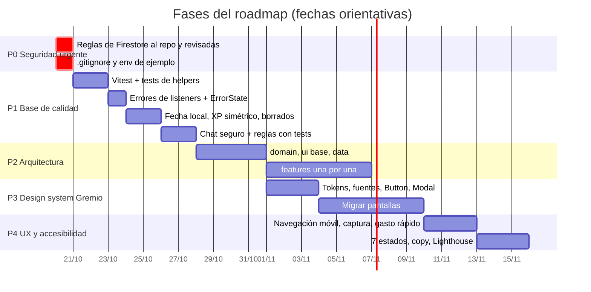

# Roadmap: de "hoy" a "objetivo"

> La brecha entre las secciones "Hoy (as-is)" y "Objetivo (to-be)" de todos los docs, ordenada por riesgo. Cada fase deja la app andando y mejor que antes. Las estimaciones son de trabajo con un agente de IA + revisión de Gastón.

## Vista general

P2 y P3 se pueden pisar: el design system se aplica a cada feature a medida que se mueve.

## P0 · Seguridad urgente (≈ 1 hora)

| # | Tarea | Por qué | Doc |
|---|---|---|---|
| 0.1 | Copiar las reglas de la consola a `firestore.rules` y revisar que exijan `request.auth.uid == uid` | repo público + login abierto a cualquier cuenta de Google | [firestore-rules.md](../05-seguridad/firestore-rules.md) |
| 0.2 | Agregar `.env` y `.env.*` (menos `!.env.local.example`) al `.gitignore` | hoy `.env` no está ignorado | [entornos-y-deploy.md](../07-operaciones/entornos-y-deploy.md) |
| 0.3 | ✅ Sacar `VITE_CLAUDE_API_KEY` de `.env.local.example` | hecho en este cambio | — |

## P1 · Base de calidad (≈ 1 semana)

| # | Tarea | Arregla | Criterio |
|---|---|---|---|
| 1.1 | ✅ Instalar Vitest; tests de `xpLevel`, `calcStreak`, `streakMultiplier`, recurrencia, `buildTree`, `renderMarkdown` | 0 tests | C7 ≥ 80 % |
| 1.2 | ✅ Callback de error en los 20 `onSnapshot` + `ErrorState` con Reintentar; contar listeners con un `Set` | spinner infinito | S1, AC-SES-3 |
| 1.3 | ✅ `hoyLocal()` en `utils/fecha.ts` para todo el front ([ADR-0007](../08-decisiones/ADR-0007-fecha-local.md)) | "mañana" después de las 21:00 | AC-DASH-4 |
| 1.4 | ✅ XP simétrico al desmarcar (`xpPorFecha`) | XP de más con racha | AC-HAB-3 |
| 1.5 | ✅ Borrar misión: cascada de hijas + limpiar prerequisitos y rocas | huérfanas y bloqueos eternos | AC-MIS-4, AC-MIS-5 |
| 1.6 | ✅ `/api/cerebro-chat`: uid del token + `ALLOWED_UIDS` + 20 pedidos por minuto + tope de body (sin firebase-admin: el uid sale de `accounts:lookup`) | cualquier cuenta usa Groq | [modelo-amenazas.md](../05-seguridad/modelo-amenazas.md) |
| 1.7 | ⏳ (sesión P0) Reglas con validación + 11 tests del emulador | [ADR-0006](../08-decisiones/ADR-0006-firestore-rules.md) | S2 |
| 1.8 | ✅ Lint en 0 y `"strict": true` explícito | 24 errores → 0 | C1, C2 |
| 1.9 | ✅ Cerrar sesión limpia IndexedDB y `localStorage`; exportar todas las colecciones | privacidad | AC-SES-4, AC-AJU-2 |

## P2 · Arquitectura (≈ 2 semanas)

Los 7 pasos de [carpetas-objetivo.md](../04-arquitectura/carpetas-objetivo.md#orden-de-migración-cada-paso-deja-la-app-andando) ([ADR-0005](../08-decisiones/ADR-0005-partir-app-tsx.md)): `domain/` → `ui/` → `data/useColeccion` → Diario y Cerebro → Hábitos y Misiones → resto → `AppShell`. Incluye **listeners por pantalla** y **code-splitting** con `React.lazy`.

Meta: `App.tsx` < 150 líneas · JS inicial ≤ 250 KB gzip · ≤ 6 listeners al arrancar.

## P3 · Design system Gremio (≈ 2 semanas)

| # | Tarea | Doc |
|---|---|---|
| 3.1 | `Button` + `IconButton` y reemplazo de los 38 `bg-blue-600 text-white` | [componentes.md](../03-design-system/componentes.md) |
| 3.2 | `Modal` accesible (dialog, Escape, foco) + `Toast` con live region | [accesibilidad-responsive.md](../03-design-system/accesibilidad-responsive.md) |
| 3.3 | Nuevo `@theme` (colores, radios, sombras, movimiento) + Nunito y DM Sans | [fundamentos.md](../03-design-system/fundamentos.md) |
| 3.4 | Re-apuntar y después borrar las paletas remapeadas (`slate`, `blue`…) y los `dark:` sobrantes | |
| 3.5 | Migrar pantalla por pantalla: Dashboard → Quests → Misiones → Gym → Atributos → Billetera → Cerebro → Ajustes | |
| 3.6 | Emojis estructurales → íconos; insignias de rango, nivel y racha | [estilo-e-identidad.md](../03-design-system/estilo-e-identidad.md) |
| 3.7 | `MotionConfig reducedMotion="user"`, tokens de movimiento, barras con `scaleX` | [movimiento.md](../03-design-system/movimiento.md) |

## P4 · UX y accesibilidad (≈ 1 semana)

| # | Tarea | Doc |
|---|---|---|
| 4.1 | Bottom nav Hoy · Quests · Misiones · Cerebro · Más | [accesibilidad-responsive.md](../03-design-system/accesibilidad-responsive.md#responsive) |
| 4.2 | Captura rápida flotante al Inbox; gasto rápido de 2 campos | [journeys.md](../02-ux/journeys.md) |
| 4.3 | Los 7 estados en las 11 pantallas | [estados-y-excepciones.md](../02-ux/estados-y-excepciones.md) |
| 4.4 | Copy: los 7 textos en inglés y el glosario | [ux-writing.md](../02-ux/ux-writing.md) |
| 4.5 | Aviso de Calendar vencido; chip "Edición parcial" en La Gaceta | [flujos.md](../02-ux/flujos.md) |
| 4.6 | Medir Lighthouse, axe y teclado; actualizar [criterios-objetivos.md](../06-calidad/criterios-objetivos.md) | |
| 4.7 | Gym: volver a poder crear, editar y borrar rutinas y ejercicios. La UI se perdió en el rediseño de Gym (PR #31); `deleteRutina`, `deleteEjercicio` y el modal `ejercicio` siguen en `App.tsx` sin nada que los llame | [estados-y-excepciones.md](../02-ux/estados-y-excepciones.md) |

## Después

- CI en GitHub Actions + Playwright con los 5 flujos E2E ([estrategia-pruebas.md](../06-calidad/estrategia-pruebas.md)).
- Registro de errores en producción.
- XP para Misiones y Carisma (gancho `xpOtorgado` ya existe en personas y grupos).
- Búsqueda semántica en el chat; historial del chat en Firestore.
- Confirmar el nombre del producto (Questflow).
