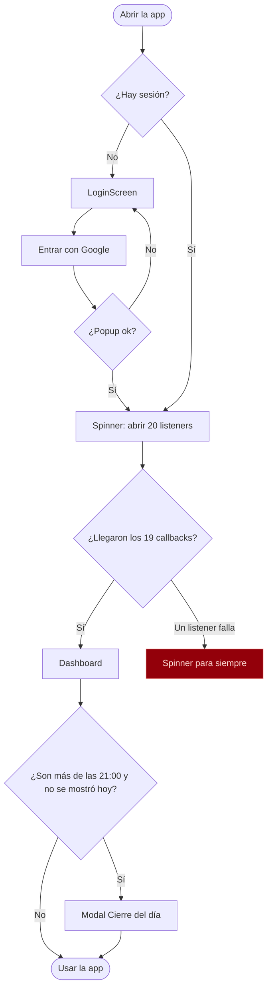
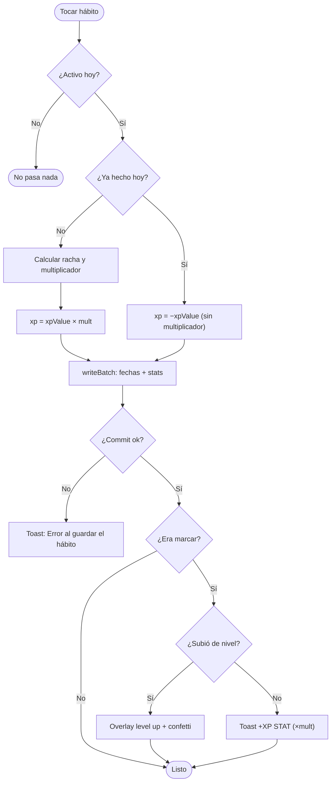
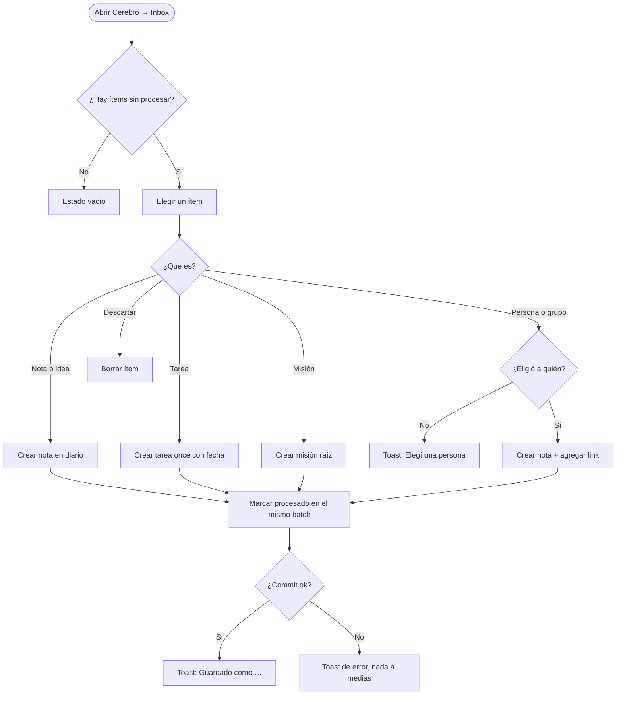
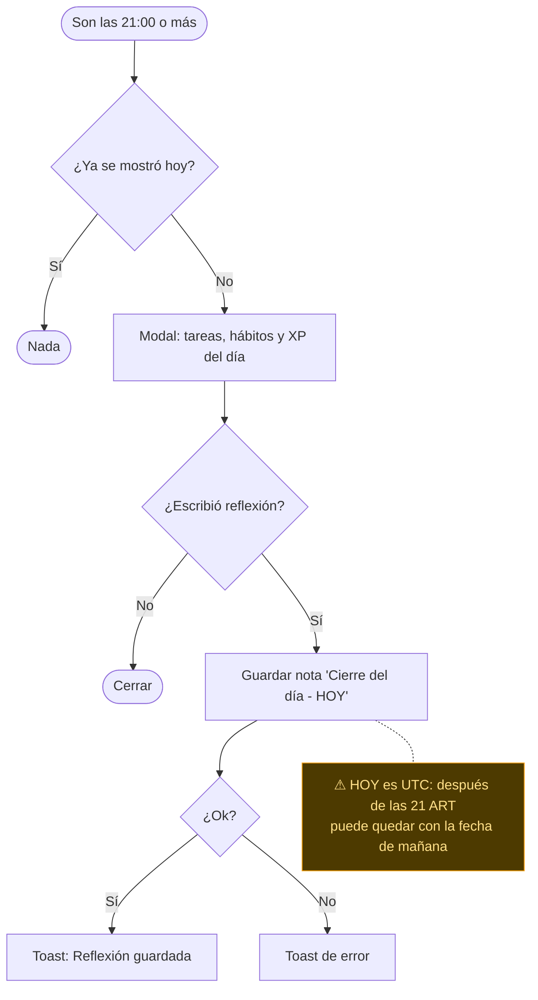
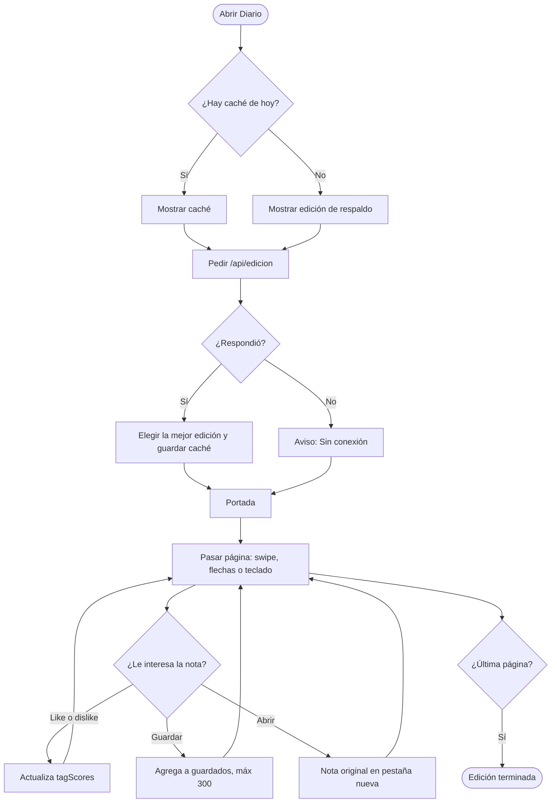

# Diagramas de flujo

> Diagrama ①. Los 5 flujos de usuario más usados, con sus decisiones y salidas de error. Los rombos son decisiones; los nodos rojos son errores que hoy no tienen buena salida.

## 1. Entrar a la app

Código: `App.tsx:260`, `App.tsx:302-339`, `App.tsx:1961-1975`.

## 2. Completar un hábito

Código: `toggleHabit`, `App.tsx:585-623`.

## 3. Procesar un ítem del Inbox

Código: `procesarInbox`, `App.tsx:1669-1726`; UI en `components/CerebroInbox.tsx`.

## 4. Cierre del día

Código: `App.tsx:343-351`, `guardarReflexionCierreDia` `App.tsx:1477-1495`, `components/CierreDia.tsx`.

## 5. Leer La Gaceta

Código: `components/DiarioEdicion.tsx`, `utils/edicion.ts`.

## Objetivo (to-be)

| Flujo | Cambio |
|---|---|
| 1 | La salida "Un listener falla" lleva a una pantalla de error con **Reintentar** y **Cerrar sesión**. |
| 2 | Desmarcar resta el XP que realmente se sumó ese día. |
| 3 | Sin cambios de flujo; agregar **Deshacer** en el toast durante 5 s. |
| 4 | Fecha local; el modal muestra rachas en juego. |
| 5 | Mostrar "Edición parcial" si la edición vino degradada. |
