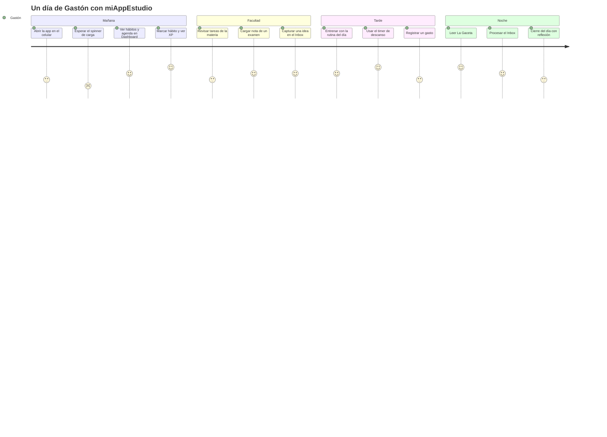
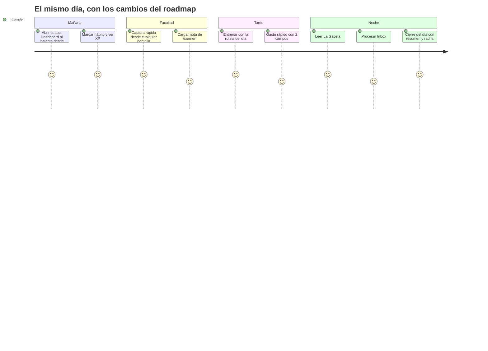

# Mapa de experiencia (journey)

> Diagrama ⑧, parte experiencia. Un día típico usando la app. Puntaje 1–5 = cómo se siente hoy ese paso (5 = fluye, 1 = frustra), estimado a partir del código y del flujo real.

## Hoy (as-is)

### Puntos de dolor (con evidencia)

| Paso | Dolor | Evidencia |
|---|---|---|
| Abrir la app | Spinner hasta que llegan 19 listeners; texto en inglés "Loading hero data…" | `App.tsx:1976` |
| Abrir la app (falla) | Si un permiso falla, el spinner no termina nunca | `App.tsx:304-339` sin callback de error |
| Navegar en el celular | La barra inferior muestra 5 de 10 tabs; Diario, Cerebro, Billetera y Calendario quedan en el menú hamburguesa | `App.tsx:2287` |
| Registrar un gasto | Formulario en modal; para un gasto de todos los días son 5 campos | `App.tsx:2022-2177` |
| Cierre del día | Aparece solo después de las 21:00; la fecha de la reflexión sale en UTC y puede quedar con la fecha de mañana | `App.tsx:343-351`, `App.tsx:1483` |
| Marcar y desmarcar hábito | Con racha, desmarcar no devuelve todo el XP que sumó | `App.tsx:599` |

## Objetivo (to-be)

Cambios que suben cada puntaje:

1. **Arranque sin bloqueo:** mostrar el Dashboard con la caché de Firestore apenas llega `stats` y `habitos`; el resto carga por detrás.
2. **Navegación móvil:** bottom bar con Hoy, Quests, Misiones, Cerebro y un "Más" que abre el resto; captura rápida flotante.
3. **Gasto rápido:** monto + categoría; fecha y moneda por defecto.
4. **Cierre del día:** muestra XP del día, rachas en juego y la reflexión, con fecha local.
