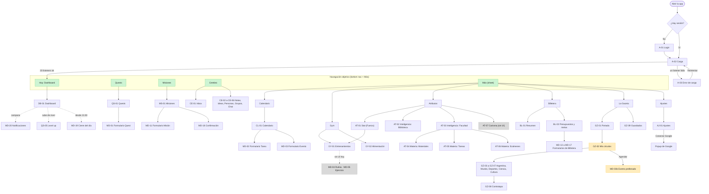

# Mapa de pantallas

> Todas las pantallas, modales y overlays de la app, agrupados por navegación, con su caso de uso ([casos-de-uso.md](../01-producto/casos-de-uso.md)) y sus criterios de aceptación ([criterios-aceptacion.md](../06-calidad/criterios-aceptacion.md)). Relevado sobre `main` en el commit `0b45eaa` (`front/src/App.tsx`, `NAV` y `PAGE_TITLE`). Los flujos están en [flujos.md](flujos.md) y los estados en [estados-y-excepciones.md](estados-y-excepciones.md).

## Archivos de diseño

| Qué | Enlace |
|---|---|
| FigJam: mapa de pantallas y 5 flujos | [miAppEstudio · Mapa de pantallas y flujos](https://www.figma.com/board/wjWzSeav7OFbgKr1f2Zug2) |
| Figma: componentes y wireframes (móvil 375 × 812) | [miAppEstudio · Wireframes](https://www.figma.com/design/XQv8YShR7bGLXNsRbPa7fu) |

Páginas del archivo de Figma: `Componentes` (variables, estilos y 22 conjuntos de componentes), `Móvil 375` (wireframes) y `Desktop 1440` (vacía: **pendiente**, ver [Pendiente](#pendiente)). Los IDs de los marcos (`A-01`, `DB-01`, `MD-03b`…) son los de esta página.

## Mapa

Verde = navegación objetivo (roadmap P4). Amarillo = nuevo en `main` (Mis círculos y Agendar). Gris = existe en el código pero sin pantalla.

## Navegación

| Hoy (código) | Objetivo (roadmap 4.1) |
|---|---|
| Sidebar con 10 tabs (`Dashboard`, `Calendario`, `Gym`, `Atributos`, `Quests`, `Misiones`, `Billetera`, `Diario`, `Cerebro`, `Ajustes`) | Sidebar completa en desktop (≥ 1024) y compacta en tablet |
| Bottom nav móvil con 5 tabs (`Dashboard`, `Quests`, `Misiones`, `Gym`, `Atributos`) y menú hamburguesa | Bottom nav `Hoy · Quests · Misiones · Cerebro · Más`; **Más** abre un sheet con Calendario, Gym, Atributos, Billetera, La Gaceta y Ajustes |
| Sin captura rápida | Botón flotante de captura rápida hacia el Inbox |

Wireframes: `N-01` (sheet Más). Los títulos de página siguen `PAGE_TITLE`; hoy `diario` dice "El Questflow" y debería decir "La Gaceta" ([ux-writing.md](ux-writing.md)).

## Pantalla → casos de uso → criterios de aceptación

Marcos de Figma en la página `Móvil 375`. "Estados" lista los marcos de estado que existen en Figma (de los 7 de [estados-y-excepciones.md](estados-y-excepciones.md)).

| Pantalla | Marcos | UC | AC | Estados en Figma |
|---|---|---|---|---|
| Login (`LoginScreen`) | `A-01` | UC1 | AC-SES-1 | — |
| Carga | `A-02` | UC1 | AC-SES-2 | cargando |
| Error de carga (`ErrorCarga`) | `A-03`, `A-04` (banner) | UC1 | AC-SES-3 | error |
| Cierre de sesión | `AJ-01` | UC1 | AC-SES-4 | — |
| Dashboard | `DB-01` a `DB-05` | UC2, UC3 | AC-DASH-1, AC-DASH-2, AC-HAB-1 | vacío, cargando, éxito, offline |
| Cierre del día (modal) | `MD-19` | UC15 | AC-DASH-3, AC-DASH-4 | — |
| Notificaciones (popover) | `MD-20` | UC2 | AC-DASH-1 | — |
| Level up (overlay) | `QS-05` | UC3 | AC-HAB-1, AC-HAB-2 | éxito |
| Quests | `QS-01` a `QS-04` | UC3 | AC-HAB-1 a AC-HAB-5 | vacío, vacío con filtro, error |
| Formulario Quest | `MD-01` | UC3 | AC-HAB-4, AC-HAB-5 | — |
| Calendario | `CL-01` a `CL-03` | UC4, UC5 | AC-CAL-1 a AC-CAL-4 | vacío, sin permiso |
| Formularios Tarea y Evento | `MD-02`, `MD-03` | UC4 | AC-CAL-1, AC-CAL-2 | — |
| Gym | `GY-01` a `GY-03` | UC6 | AC-GYM-1 a AC-GYM-3 | vacío |
| Formularios Rutina y Ejercicio | `MD-04`, `MD-05` | UC6 | sin AC (sin disparador hoy) | — |
| Atributos (stat) | `AT-01`, `AT-07`, `AT-09` | UC7, UC8 | AC-ATR-4 | error |
| Biblioteca | `AT-02`, `AT-08`, `MD-06` | UC7 | AC-ATR-1 | vacío |
| Facultad y materia | `AT-03` a `AT-06`, `MD-07` a `MD-10` | UC8 | AC-ATR-2, AC-ATR-3 | vacío |
| Misiones | `MS-01` a `MS-04` | UC9 | AC-MIS-1 a AC-MIS-5 | vacío, bloqueada, error |
| Formulario Misión y confirmación | `MD-11`, `MD-18` | UC9 | AC-MIS-3, AC-MIS-4, AC-MIS-5 | — |
| Billetera | `BL-01` a `BL-04` | UC10 | AC-BIL-1 a AC-BIL-3 | vacío, error |
| Formularios de Billetera | `MD-13` a `MD-17` | UC10 | AC-BIL-1, AC-BIL-3 | — |
| La Gaceta (8 páginas + Guardados) | `GZ-01` a `GZ-09` | UC11 | AC-GAC-1, AC-GAC-3, AC-GAC-4 | — |
| La Gaceta: estados | `GZ-E1` a `GZ-E4` | UC11 | AC-GAC-1, AC-GAC-2, AC-GAC-5 | cargando, offline, parcial, vacío |
| Mis círculos y Agendar (nuevo) | `GZ-02`, `MD-03b` | UC11, UC12 | **sin AC** | vacío |
| Segundo Cerebro: Inbox | `CE-01`, `CE-07`, `CE-10` | UC12 | AC-CER-1, AC-CER-2 | vacío, error |
| Segundo Cerebro: notas, personas, grupos | `CE-02` a `CE-05` | UC13 | AC-CER-5 | error (`CE-08`) |
| Segundo Cerebro: Chat | `CE-06`, `CE-09` | UC14 | AC-CER-3, AC-CER-4 | offline (sin IA) |
| Ajustes | `AJ-01` a `AJ-03` | UC5, UC16 | AC-AJU-1, AC-AJU-2 | sin permiso, éxito |
| Entrada de diario (modal sin formulario) | `MD-12` | UC13 | sin AC | — |
| Toasts | `MD-21` | transversal | — | éxito, error |

## Huecos que muestra el mapa

1. **Mis círculos y Agendar** (nuevos en `main`) no tienen UC ni AC. Falta `UC17` y criterios Dado/Cuando/Entonces (propuesta de fecha desde un mensaje de WhatsApp, evento y mensaje procesado en un solo batch).
2. **Rutinas y ejercicios:** los modales `rutina` y `ejercicio` existen pero nada los abre (roadmap 4.7).
3. **`entrada_diario`** está en el tipo del modal y no tiene formulario ni disparador.
4. **Objetivos de Carisma:** la colección `objetivos_cha` se carga y se exporta, pero no hay pantalla (`CLAUDE.md` dice "carisma → objetivos").
5. **Estados faltantes:** casi todas las pantallas no tienen cargando, offline ni parcial propios (matriz de [estados-y-excepciones.md](estados-y-excepciones.md)).

## Pendiente

- Vistas **desktop 1440 × 900** (Dashboard, Quests, Misiones) y sidebar en uso: el componente `Sidebar` existe, falta armar las pantallas. No se pudieron hacer por el límite de llamadas del plan Starter de Figma.
- Vista tablet (768–1023).
