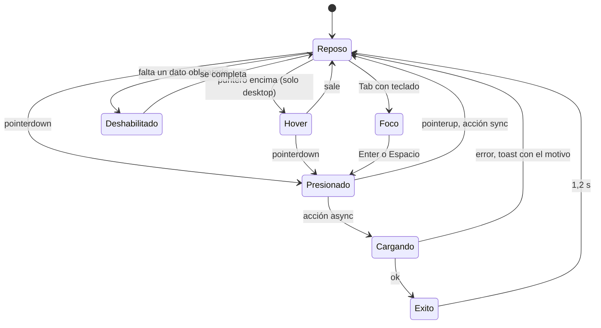

# Componentes

> Catálogo de `ui/` del Gremio. Todo componente nuevo sale de acá; si falta uno, se agrega primero a esta página (regla del [contrato de agentes](../CONTRATO-AGENTES.md)). Los tokens están en [fundamentos.md](fundamentos.md).

## Hoy (as-is)

No hay componentes base: los 234 `<button>` de la app se estilan a mano con clases sueltas. Se repiten 6 patrones:

| Patrón actual | Ejemplo | Problema |
|---|---|---|
| Primario `bg-blue-600 text-white rounded-xl` | `App.tsx:3451` (38 usos) | contraste 3,17:1 ❌ |
| Submit de formulario `w-full py-3 bg-blue-600` | `App.tsx:4714` | mismo contraste |
| Secundario con borde `border-slate-200 dark:border-slate-700` | `App.tsx:2011` | clases de modo claro en una app solo oscura |
| Peligro `bg-red-500 text-white` | `App.tsx:2015` | 3,11:1 ❌ |
| Ícono `p-2 rounded-xl` | `Modal.tsx:44` | 32 px: menos que 44 px táctiles; sin `aria-label` en varios |
| Chips `px-3 py-1.5 rounded-xl text-xs` | `App.tsx:3461` | 28 px de alto |

## Objetivo (to-be)

### Botones

#### Anatomía

```
┌──────────────────────────────┐  ← radio 16 px (radius-lg)
│  [ícono 20]  Crear quest     │  ← Nunito 800, 15 px · gap 8 px · padding 0 20 px
└──────────────────────────────┘
 ▀▀▀▀▀▀▀▀▀▀▀▀▀▀▀▀▀▀▀▀▀▀▀▀▀▀▀▀▀▀▀▀  ← escalón 4 px (ledge) del color del rol
```

#### Variantes

| Variante | Fondo | Texto | Escalón | Cuándo | Contraste |
|---|---|---|---|---|---|
| **Primario** | `primary` `#fbbf24` | `on-primary` | `primary-ledge` | **una** acción principal por pantalla: "Crear quest", "Guardar" | 11,05 |
| **Completar** | `secondary` `#34d399` | `on-secondary` | `secondary-ledge` | marcar como hecho, aportar a meta | 7,71 |
| **Secundario** | `surface-container-high` + borde 2 px `outline` | `on-surface` | `surface-container-lowest` | acciones alternativas: "Cancelar", "Copiar del mes anterior" | ≥ 12,7 |
| **Fantasma** | transparente (hover `surface-container-high`) | `on-surface-variant` | — | acciones terciarias, toolbars | 11,16 |
| **Peligro** | `danger` `#f87171` | `on-danger` | `danger-ledge` | borrar, siempre detrás de confirmación | 5,84 |
| **Épico** | `tertiary` `#c4b5fd` | `on-tertiary` | `tertiary-ledge` | "Aceptar misión épica", reclamar logro | 8,25 |

#### Tamaños

| Tamaño | Alto | Padding X | Texto | Ícono | Uso |
|---|---|---|---|---|---|
| `sm` | 36 px (área táctil extendida a 44 con `::before`) | 14 px | 14 px | 16 | desktop denso, filas de tabla |
| `md` | **44 px** (default) | 20 px | 15 px | 20 | todo |
| `lg` | 52 px | 24 px | 17 px | 24 | CTA de pantalla vacía, submit en móvil |

`full`: `w-full` en formularios de móvil.

#### Estados



| Estado | Visual | Implementación |
|---|---|---|
| Reposo | fondo del rol + escalón 4 px | `shadow-[0_4px_0_0_var(--color-primary-ledge)]` |
| Hover | fondo `*-hover` (un tono más claro) | `hover:bg-primary-hover`, solo con `@media (hover: hover)` |
| Presionado | se hunde 3 px, escalón a 1 px, `scale(0.98)` | `active:translate-y-[3px] active:shadow-[0_1px_0_0_…]` |
| Foco | anillo 3 px `primary` con 2 px de separación | `focus-visible:outline-3 focus-visible:outline-primary focus-visible:outline-offset-2` |
| Cargando | spinner 16 px a la izquierda, texto "Guardando…", `aria-busy="true"`, no recibe más clics | prop `loading` |
| Éxito | check 16 px + texto "Guardado" durante 1,2 s | prop `success` (opcional) |
| Deshabilitado | fondo `surface-container-high`, texto `on-surface-muted`, sin escalón, `cursor-not-allowed` | atributo `disabled`; preferir dejarlo habilitado y explicar el error al tocar |

#### API propuesta (`ui/Button.tsx`)

```tsx
type ButtonProps = {
  variante?: 'primario' | 'completar' | 'secundario' | 'fantasma' | 'peligro' | 'epico';
  tamano?: 'sm' | 'md' | 'lg';
  ancho?: 'auto' | 'full';
  icono?: LucideIcon;            // a la izquierda
  cargando?: boolean;
  children: ReactNode;           // texto: verbo, máx 3 palabras
} & ButtonHTMLAttributes<HTMLButtonElement>;
```

Reglas: siempre `<button type="button">` (o `submit` en formularios); nunca `<div onClick>`; texto en infinitivo ("Guardar", no "Guardado" ni "OK").

### Botón de ícono

- 44 × 44 px, radio 14 px, ícono 20 px, variante fantasma por defecto.
- **`aria-label` obligatorio** ("Cerrar", "Borrar quest").
- Separación mínima 8 px entre dos botones de ícono.

### Chip / filtro

| | Reposo | Seleccionado |
|---|---|---|
| Fondo | `surface-container` | `primary` al 15 % (`#3b2d12`) |
| Borde | 2 px `outline` | 2 px `primary` |
| Texto | `on-surface-variant` 13 px DM Sans 700 | `primary` (8,01:1) |
| Alto | 36 px (área táctil 44) | igual |
| Accesibilidad | `aria-pressed="false"` | `aria-pressed="true"` + check 14 px (no solo color) |

Chip de stat: el color del stat en ícono y borde; el texto queda en `on-surface`.

### Tabs segmentadas

Contenedor `surface-container-low`, radio 18 px, padding 4 px. Pestaña activa: `surface-container-highest` + escalón 2 px + texto `on-surface`; inactiva: texto `on-surface-variant`. Indicador animado con `layoutId` (como el de la bottom nav actual, `App.tsx:2300`). `role="tablist"` / `role="tab"` / `aria-selected`.

### Card

`surface-container`, radio 22 px, borde 3 px `outline-variant`, `shadow-card`, padding 16 (móvil) / 20 (desktop). Card tocable: estados de presionado como el botón (se hunde 2 px). Dentro de una lista densa: filas con separador en vez de cards anidadas.

### Fila de quest

```
┌────────────────────────────────────────────────┐
│ [□ 28px]  Leer 20 páginas       +25 INT  [llama]8 │  ← 56 px de alto
│           Diaria · Inteligencia                 │
└────────────────────────────────────────────────┘
```

- El cuadrado de check es el área táctil principal (toda la fila también responde).
- Al completar: el cuadrado se llena de verde con check, rebota (`ease-squish`), aparece "+25 XP" que sube y se desvanece.
- `role="checkbox"` + `aria-checked` en el control.

### Barra de progreso / XP

Alto 10 px (12 px en el héroe), track `surface-container-lowest`, relleno `secondary` con brillo interno arriba (`inset 0 2px 0 rgb(255 255 255 / 0.25)`), radio completo. `role="progressbar"` + `aria-valuenow` / `aria-valuemax` + texto visible "1.240 / 2.000 XP".

### Input

Alto 48 px, fondo `surface-container-lowest`, borde 2 px `outline`, radio 14 px, texto 16 px (evita el zoom de iOS). Foco: borde `primary` + anillo. Label visible arriba (nunca solo placeholder); error debajo en `error` con ícono y `aria-describedby`.

### Modal / bottom sheet

- Móvil: bottom sheet radio 28 px arriba, con "agarradera"; desktop: modal centrado `max-w-md`.
- `surface-container-highest` + `shadow-raised`, scrim `rgb(0 0 0 / 0.6)`.
- `role="dialog"`, `aria-modal="true"`, `aria-labelledby` al título; **Escape** cierra; foco atrapado y devuelto al disparador al cerrar. (Hoy no tiene ninguna de las tres cosas: `Modal.tsx`.)
- Botones: primario a la derecha (desktop) o arriba (móvil, ancho completo); "Cancelar" secundario.

### Toast

Abajo al centro, encima de la bottom nav, radio 16 px, `surface-container-highest`, ícono de estado + texto + acción opcional "Deshacer". 4 s; `role="status"` + `aria-live="polite"` (errores: `role="alert"`). Nunca roba el foco.

### Estado vacío, error y carga

| Componente | Contenido |
|---|---|
| `EmptyState` | ficha clay 64 px con ícono, título (Nunito 18), una línea, botón primario |
| `ErrorState` | ícono `AlertTriangle` en `error`, qué pasó, botón secundario "Reintentar" |
| `Skeleton` | bloques `surface-container-high` con la forma del contenido; pulso de opacidad 0,6↔1 cada 1,2 s (sin pulso con movimiento reducido) |
| `OfflineBadge` | chip `warning` "Sin conexión" fijo arriba |

### Insignias del personaje

| Componente | Spec |
|---|---|
| `RankBadge` | círculo 48 / 64 px, borde 3 px color del rango, letra Nunito 900; Monarch con borde `tertiary` doble |
| `LevelChip` | ficha `primary` con "Nv 24" Nunito 900 |
| `StreakChip` | `Flame` + número; borde `primary` desde 7 días |
| `StatChip` | ícono + abreviatura (FUE, INT…) con el color del stat |

## Orden de construcción

1. `Button`, `IconButton` → reemplazan los 38 `bg-blue-600 text-white` (arregla el contraste en todos lados de una vez).
2. `Modal` accesible + `Toast` con live region.
3. `EmptyState`, `ErrorState`, `Skeleton`.
4. `Chip`, `SegmentedTabs`, `Card`, `ProgressBar`, `Input`.
5. Insignias del personaje.
