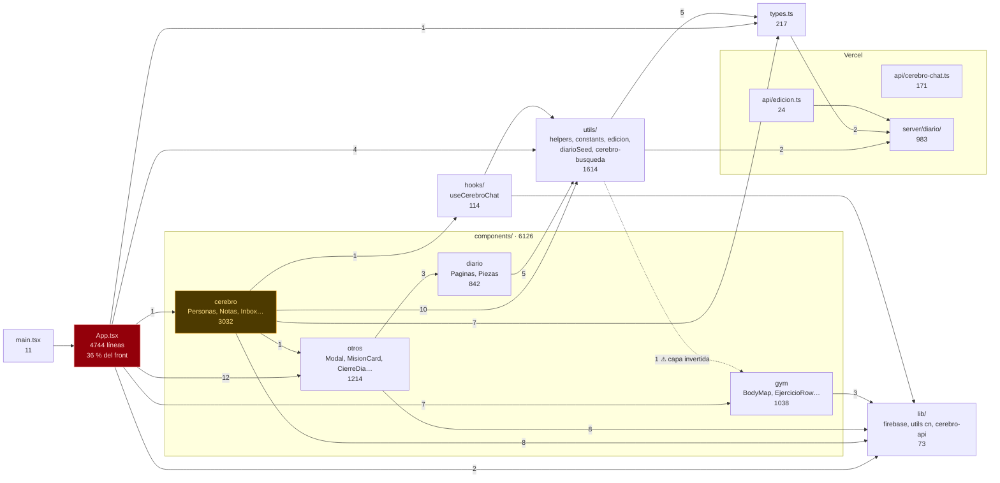
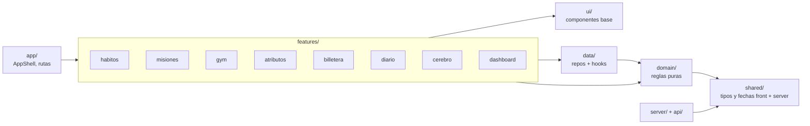

# Archify: mapa del código real

> Diagrama ⑩. Sale del código, no de la intención. Dos fuentes:
> 1. **graphify** (`graphify update .`, solo AST, sin LLM) sobre `front/src`, `api` y `server`: 445 nodos, 1227 aristas, 17 comunidades.
> 2. **Grafo de imports** a nivel archivo (script Node, solo imports relativos): 59 archivos, 134 imports.
>
> Fecha del relevamiento: 2026-10-19, commit `353aa7f`. Para regenerarlo, ver [Cómo actualizar](#cómo-actualizar).

## Hoy (as-is)

### Mapa de módulos

El grosor de cada caja es el tamaño (líneas). Las flechas son imports reales; el número es cuántos.



### Nodos dios (más conectados)

| # | Nodo | Aristas | Qué significa |
|---|---|---|---|
| 1 | `cn()` (`lib/utils.ts`) | 50 | Helper de clases de Tailwind; normal que esté en todos lados |
| 2 | `App()` (`App.tsx`) | 27 imports salientes | El componente que hace todo |
| 3 | `FSEntradaDiario` | 22 | Las notas conectan personas, grupos, inbox y chat |
| 4 | `FSPersona` / `FSGrupo` | 21 / 21 | Núcleo del Segundo Cerebro |
| 5 | `types.ts` (por archivo) | importado por 25 archivos | Contrato compartido de todo el front |

### Comunidades que detectó graphify

| Comunidad | Archivos centrales | Lectura |
|---|---|---|
| Diario (páginas) | `components/diario/Paginas.tsx`, `Piezas.tsx` | La Gaceta está bien aislada |
| Diario (servidor) | `server/diario/*`, `api/edicion.ts` | Backend de noticias autocontenido |
| Segundo Cerebro | `SegundoCerebro.tsx`, `CerebroInbox.tsx`, `CerebroChat.tsx` | Ya es casi una feature separada |
| UI de Cerebro | `CerebroLayout.tsx`, `CerebroGrupos.tsx` + `cn` | Comparten layout master/detalle |
| App + Gym | `App.tsx`, `Gym*.tsx`, `LoginScreen.tsx` | Gym todavía depende del estado de App |
| Lógica RPG | `helpers.ts` + `App()` | Reglas de XP mezcladas con la UI |
| Tipos | `types.ts`, `CapituloRow.tsx` | |
| Chat backend | `api/cerebro-chat.ts` | Aislado |

### Hallazgos

1. **`App.tsx` concentra el 36 % del front** (4744 de 13 069 líneas) y es el único que importa casi todos los componentes. Es el cuello de botella de cualquier cambio.
2. **Capa invertida:** `utils/muscleMap.ts:1` importa un tipo de `components/BodyMap`. La lógica no debería depender de la UI. Arreglo: mover `MuscleId` a `types.ts`.
3. **El front importa del servidor:** `types.ts:2` y `utils/edicion.ts:10` importan de `server/diario/`. Es intencional (tipos y fechas compartidas) y funciona, pero conviene una carpeta `shared/` explícita.
4. **Sin ciclos de imports** (graphify: "None detected").
5. **Segundo Cerebro y Diario ya están casi modularizados**; son los primeros candidatos para mover a `features/` sin riesgo.
6. **Falsos positivos de graphify:** las aristas "sorprendentes" `CerebroPersonas → lista()` y `useCerebroChat → texto()` (marcadas INFERRED, confianza 0,57) son coincidencias de nombre con funciones de `server/diario/xml.ts`, no llamadas reales.

## Objetivo (to-be)

El mismo mapa después de [carpetas-objetivo.md](carpetas-objetivo.md):



Reglas de dependencia (se pueden chequear con `eslint-plugin-boundaries` o `dependency-cruiser`):

| Desde | Puede importar | No puede importar |
|---|---|---|
| `domain/` | `shared/` | React, Firebase, `ui/`, `features/` |
| `data/` | `domain/`, `shared/`, Firebase | `ui/`, `features/` |
| `ui/` | nada del dominio | `data/`, `features/` |
| `features/x` | `ui/`, `data/`, `domain/`, `shared/` | otra `features/y` |
| `server/` | `shared/` | todo `front/` |

Meta medible: ningún archivo de `front/src` supera **400 líneas**; `App.tsx` queda por debajo de **150**.

## Cómo actualizar

```bash
graphify update <copia-de-front-api-server>
```

```bash
node scripts/imports.mjs .
```

graphify escribe en `graphify-out/` de la carpeta que analiza: correrlo sobre una copia o agregar `graphify-out/` al `.gitignore`. El script de imports está en este mismo commit como referencia (ver ADR-0003).
