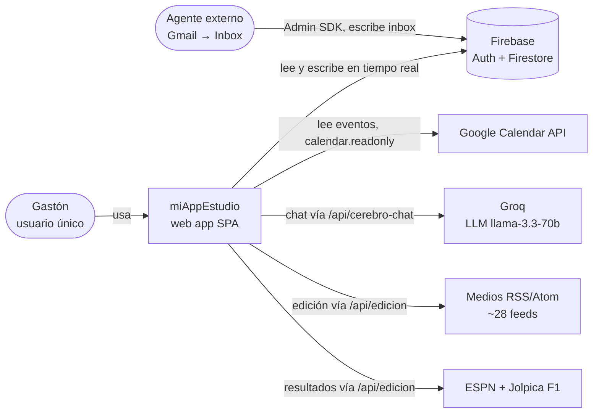
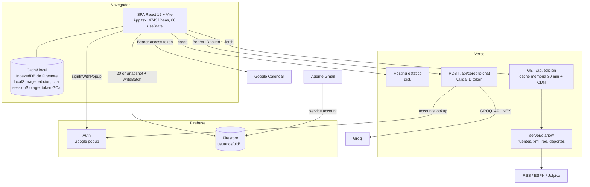
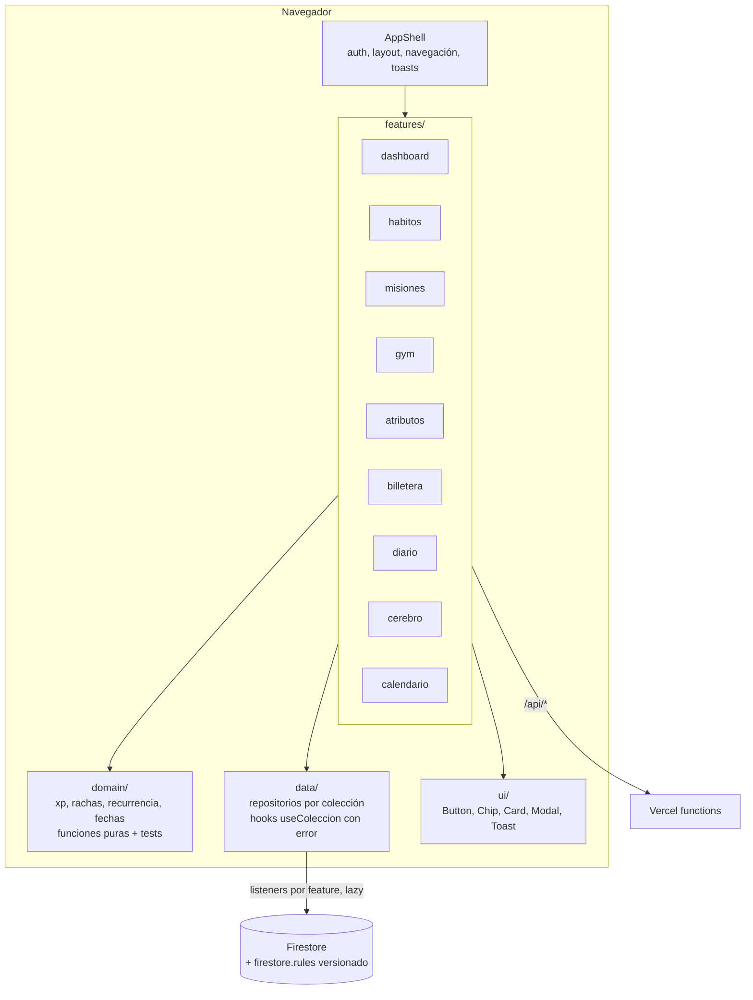

# Arquitectura (C4 nivel 1 y 2)

> Diagrama ⑤. Cómo se reparte el sistema entre el navegador, Firebase, Vercel y los servicios externos.

## Hoy (as-is)

### Nivel 1 — Contexto

### Nivel 2 — Contenedores

### Hechos que sostienen el diagrama

| Hecho | Dónde |
|---|---|
| Firebase con caché persistente multi-pestaña | `front/src/lib/firebase.ts:21` |
| 20 listeners `onSnapshot` (19 cuentan para `dataReady`) | `front/src/App.tsx:304-339` |
| Escrituras atómicas con `writeBatch` / `runTransaction` | `App.tsx:606`, `App.tsx:968`, `App.tsx:1682` |
| `/api/edicion`: caché en memoria + `s-maxage=1800` | `server/diario/edicion.ts:205-216`, `api/edicion.ts:12-15` |
| `/api/cerebro-chat`: valida token con Identity Toolkit | `api/cerebro-chat.ts:35-48` |
| Llamada a Groq con key del servidor | `api/cerebro-chat.ts:131` |
| Google Calendar desde el navegador | `App.tsx:280-299`, `App.tsx:1784-1799` |
| En dev, Vite solo sirve `/api/edicion` | `vite.config.ts` (middleware `diarioApiDev`) |

### Problemas de arquitectura

1. **Un solo componente hace todo.** `App.tsx` mezcla estado, acceso a datos, reglas de negocio (XP, rachas) y 10 pantallas. Cualquier cambio toca el mismo archivo.
2. **Sin capa de datos.** Cada handler arma su `doc(db, 'usuarios', uid, ...)` a mano; no hay un lugar único para validar o versionar el esquema.
3. **Todo se suscribe al arrancar.** Los 20 listeners se abren aunque el usuario nunca entre a Billetera o Gym.
4. **La seguridad depende de reglas que no están en el repo** (ver [modelo de amenazas](../05-seguridad/modelo-amenazas.md)).

## Objetivo (to-be)

Cambios clave (cada uno tiene su ADR):

| Cambio | Por qué | ADR |
|---|---|---|
| Partir `App.tsx` en `features/` + `domain/` + `data/` + `ui/` | Poder cambiar un módulo sin romper otro | [ADR-0005](../08-decisiones/ADR-0005-partir-app-tsx.md) |
| Listeners por feature, abiertos al entrar (lazy) | Menos lecturas, arranque más rápido | ADR-0005 |
| `firestore.rules` en el repo + tests con emulador | El repo es público; la seguridad tiene que ser revisable | [ADR-0006](../08-decisiones/ADR-0006-firestore-rules.md) |
| Fecha local de Argentina en un solo helper | Hoy "hoy" es UTC | [ADR-0007](../08-decisiones/ADR-0007-fecha-local.md) |
| Sigue Firebase desde el cliente, sin backend propio | Sirve para un usuario; menos cosas que operar | [ADR-0001](../08-decisiones/ADR-0001-firebase-cliente.md) |

Detalle de carpetas: [carpetas-objetivo.md](carpetas-objetivo.md).
