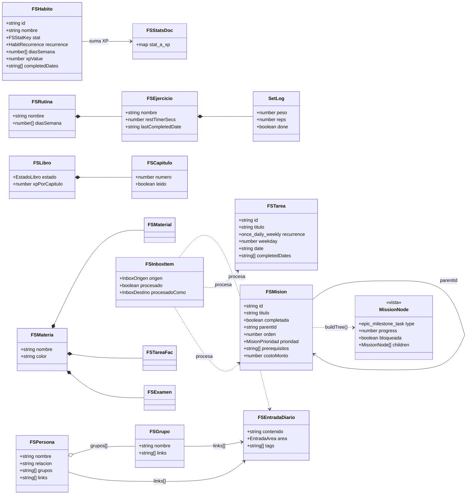
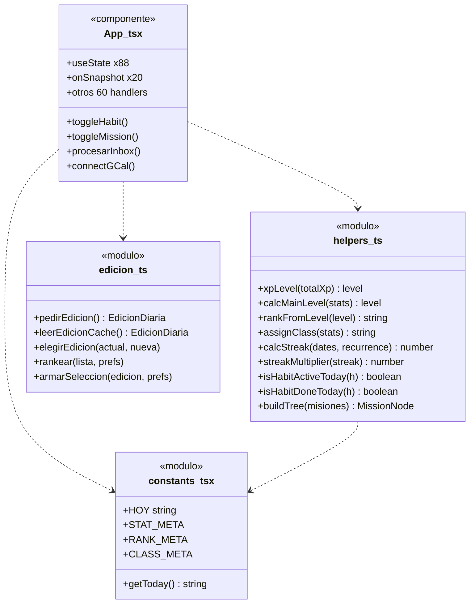
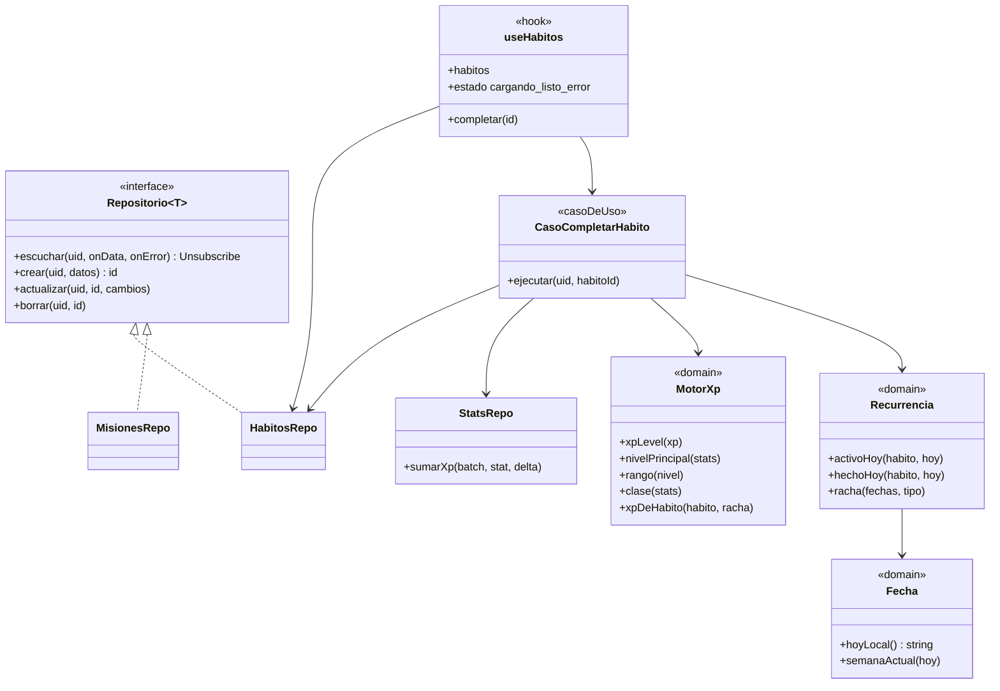

# Diagrama de clases

> Diagrama ⑥. La app no usa clases: son tipos de TypeScript + funciones. El diagrama muestra **tipos como clases** y **módulos de funciones como clases estáticas**.

## Hoy (as-is)

### Tipos de dominio (`front/src/types.ts`)

### Módulos de lógica

Reglas que viven en `helpers.ts` (verificadas):

| Regla | Función | Línea |
|---|---|---|
| Cada nivel cuesta 100 XP más que el anterior | `xpLevel` | `helpers.ts:6` |
| Nivel principal = piso del promedio de los 6 stats | `calcMainLevel` | `helpers.ts:160` |
| Rango cada 10 niveles: E, D, C, B, A, S, SS, Monarch | `rankFromLevel` | `helpers.ts:174` |
| Clase según el stat más alto | `assignClass` | `helpers.ts:186` |
| Multiplicador de racha 1,25 / 1,5 / 2,0 a los 7 / 14 / 30 | `streakMultiplier` | `helpers.ts:220` |

## Objetivo (to-be)

Las reglas pasan a `domain/` como funciones puras con tests. El acceso a Firestore pasa a `data/` con un repositorio por colección. Las pantallas solo llaman hooks.

Regla: `domain/` no importa nada de React ni de Firebase. Así se testea con Vitest sin emulador.
