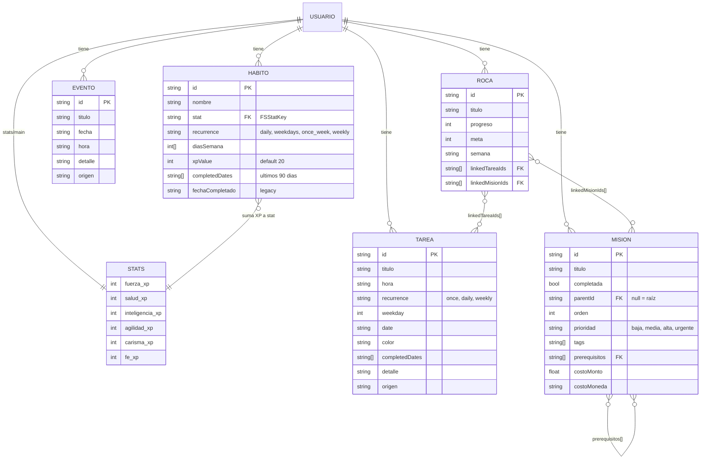
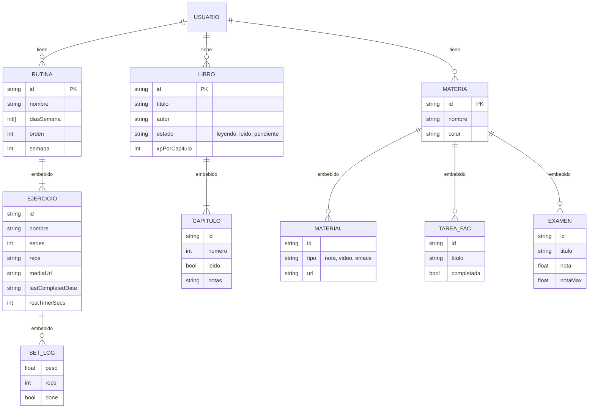
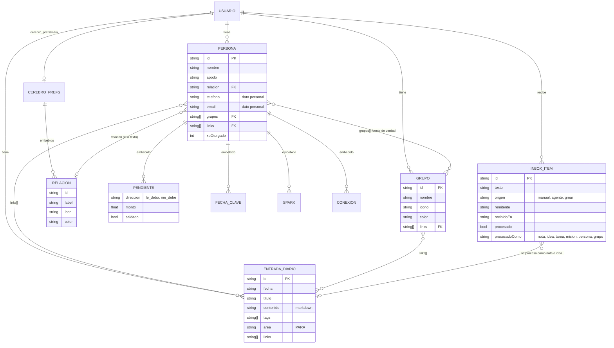
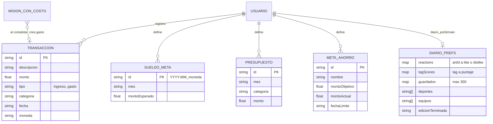

# Modelo de datos (entidad-relación)

> Diagrama ③. Todo vive bajo `usuarios/{uid}/` en Firestore. Fuente: `front/src/types.ts` y los listeners de `front/src/App.tsx:304-339`.

## Hoy (as-is)

### Inventario

**17 colecciones + 3 documentos únicos**, todos bajo `usuarios/{uid}/`:

| Ruta | Tipo TS | Escribe | Nota |
|---|---|---|---|
| `stats/main` | `FSStatsDoc` | App.tsx (con `increment`) | `{ fuerza: { xp }, salud: { xp }, … }` |
| `habitos` | `FSHabito` | App.tsx | `completedDates` recortado a 90 días |
| `tareas` | `FSTarea` | App.tsx, inbox | `completedDates` por fecha |
| `eventos` | `FSEvento` | App.tsx | `detalle` y `origen` opcionales |
| `misiones` | `FSMision` | App.tsx, inbox | lista plana con `parentId` + `orden` |
| `rocas` | `FSRoca` | App.tsx | prioridades semanales |
| `rutinas` | `FSRutina` | App.tsx | ejercicios embebidos |
| `libros` | `FSLibro` | App.tsx | capítulos embebidos |
| `materias` | `FSMateria` | App.tsx | materiales, tareas y exámenes embebidos |
| `diario` | `FSEntradaDiario` | App.tsx, inbox | notas del Segundo Cerebro (no es La Gaceta) |
| `personas` | `FSPersona` | App.tsx | `grupos[]` es la fuente de verdad de la membresía |
| `grupos` | `FSGrupo` | App.tsx | |
| `inbox` | `FSInboxItem` | App.tsx, **agente Gmail** (Admin SDK) | ids `gmail-<id>` para el agente |
| `objetivos_cha` | `FSObjetivoCHA` | **nadie** (solo se lee) | resto de una versión vieja |
| `transacciones` | `FSTransaccion` | App.tsx, misiones con costo | |
| `sueldos_meta` | `FSSueldoMeta` | App.tsx | id `{YYYY-MM}_{moneda}` |
| `presupuestos` | `FSPresupuesto` | App.tsx | |
| `metas_ahorro` | `FSMetaAhorro` | App.tsx | `montoActual` con `increment` |
| `diario_prefs/main` | `FSDiarioPrefs` | App.tsx (`merge: true`) | reacciones, tagScores, guardados |
| `cerebro_prefs/main` | `{ relaciones: FSRelacion[] }` | App.tsx (`merge: true`) | si no existe se usa `RELACION_META` |

`FSLogro` existe en `types.ts:158` pero **no se guarda**: los logros se calculan en cada render.

### Núcleo RPG: stats, hábitos, tareas, misiones

### Estudio y Gym (arrays embebidos)

### Segundo Cerebro

### Billetera y Diario (La Gaceta)

### Problemas del modelo

1. **Sin validación de esquema.** Los docs se castean con `as FSHabito` (`App.tsx:310`); un campo mal escrito no se detecta.
2. **Referencias sin integridad.** Borrar una misión no limpia los `prerequisitos` ni los `linkedMisionIds` que la apuntan.
3. **Arrays embebidos que crecen.** `setsLog`, `capitulos` y `materiales` viven dentro del doc padre; Firestore corta en 1 MiB por documento.
4. **Colección muerta.** `objetivos_cha` se lee y nunca se escribe.
5. **Fechas como `string` UTC** (`constants.tsx:6-7`), ver [ADR-0007](../08-decisiones/ADR-0007-fecha-local.md).

## Objetivo (to-be)

- **Esquema validado en un solo lugar.** Cada colección tiene un conversor `withConverter` en `data/` que valida al leer y al escribir.
- **Campo `schemaVersion`** en cada doc nuevo, para migrar sin romper datos viejos.
- **Limpieza de referencias** al borrar: misiones (prerequisitos, rocas), notas (links de personas y grupos). Va en el mismo `writeBatch`, como ya hace `deleteGrupo` (`App.tsx:1744-1760`).
- **Sacar `objetivos_cha`** o darle una pantalla que lo escriba.
- **`setsLog` a subcolección** si un ejercicio supera unas 200 series registradas.
- **Las reglas de Firestore** validan los mismos tipos (ver [firestore-rules.md](../05-seguridad/firestore-rules.md)).
