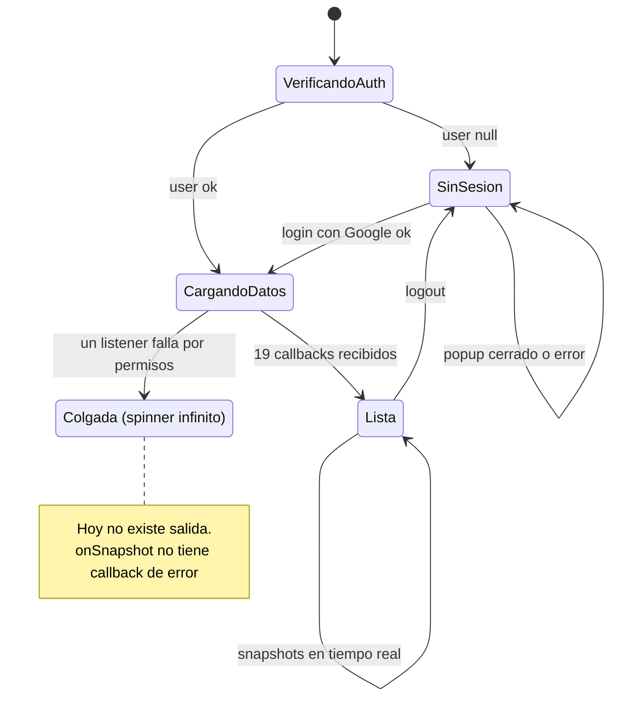
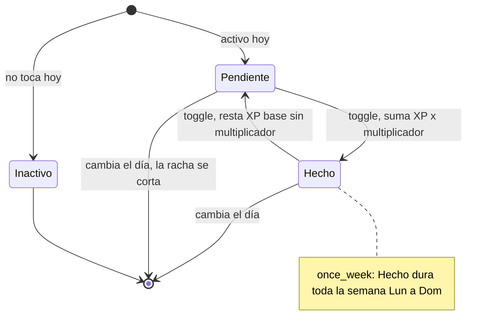
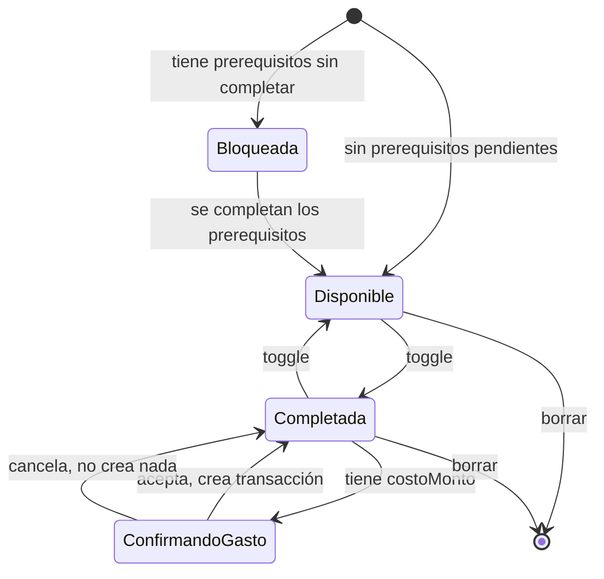
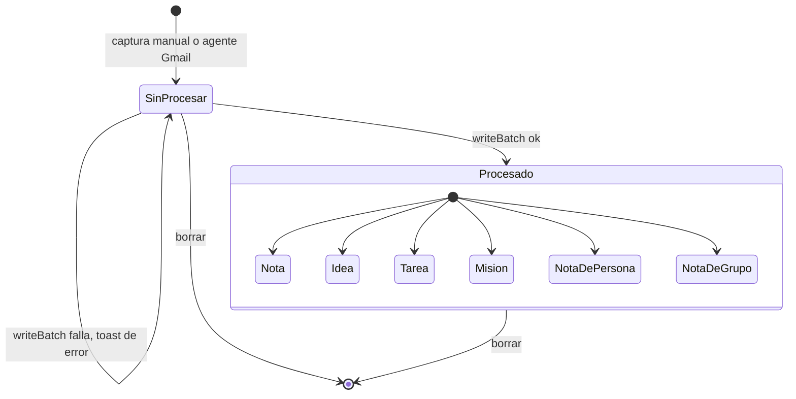
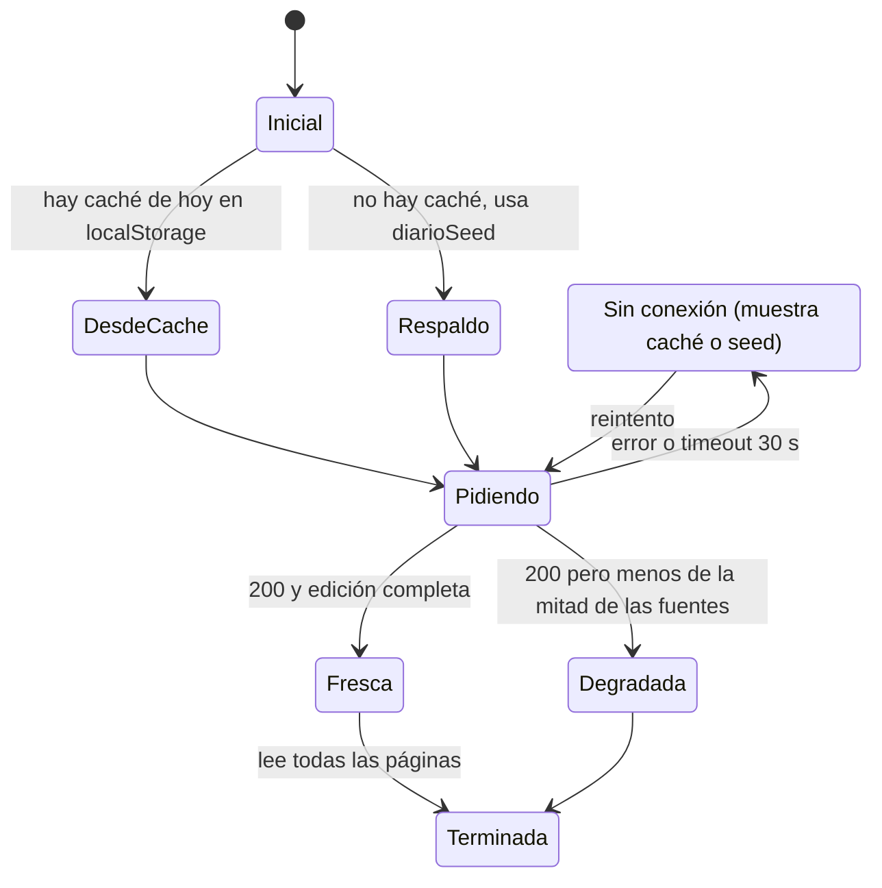
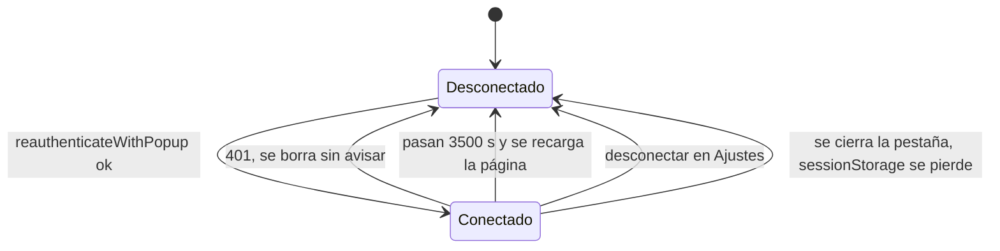

# Diagramas de estado

> Diagrama ②. Los 6 objetos que cambian de estado y en los que un error se nota. Los estados de **pantalla** (vacío, cargando, offline…) están en [estados-y-excepciones.md](../02-ux/estados-y-excepciones.md).

## Hoy (as-is)

### 1. Sesión de la app

Código: `App.tsx:260` y `App.tsx:302-339`; spinners en `App.tsx:1961` y `App.tsx:1971`.

### 2. Hábito en el día

Código: `helpers.ts:82-100` (activo/hecho), `App.tsx:585-623` (toggle).

> ⚠️ Asimetría real: al marcar suma `xpValue × multiplicador`, al desmarcar resta `xpValue × 1` (`App.tsx:599`, `mult = yaHecho ? 1 : …`). Marcar y desmarcar con racha ≥ 7 deja XP de más.

### 3. Misión

Código: `toggleMission`, `App.tsx:716-748`; `buildTree`, `helpers.ts:26`.

### 4. Ítem del Inbox

Código: `capturarInbox` `App.tsx:1652`, `procesarInbox` `App.tsx:1669`, `borrarInbox` `App.tsx:1661`.

### 5. Edición de La Gaceta (cliente)

Código: `utils/edicion.ts:222-296`, `components/DiarioEdicion.tsx:208`.

### 6. Token de Google Calendar

Código: `App.tsx:272-299`, `App.tsx:1784-1823`.

## Objetivo (to-be)

| Objeto | Cambio |
|---|---|
| Sesión | Agregar estado **Error** con "Reintentar" y "Cerrar sesión", alcanzable desde `CargandoDatos` y `Lista`. Contar listeners, no callbacks. |
| Hábito | Desmarcar resta **lo mismo** que sumó (guardar el XP otorgado por fecha en el doc). El cambio de día usa fecha local. |
| Misión | Al borrar una misión, sacarla de los `prerequisitos` de otras (si no, quedan bloqueadas para siempre). |
| Inbox | Sin cambios. Ya es atómico. |
| La Gaceta | Mostrar el estado `Degradada` en la UI ("edición parcial"). |
| Calendar | Estado **Vencido** visible con botón "Reconectar", en vez de desconectar en silencio. |
