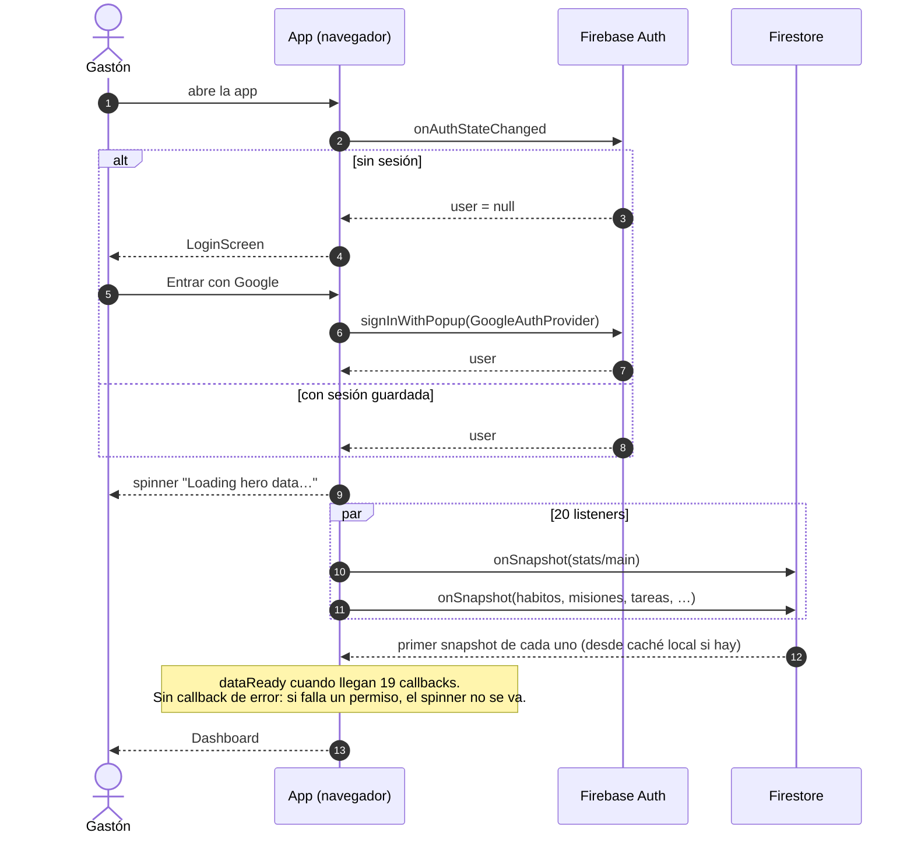
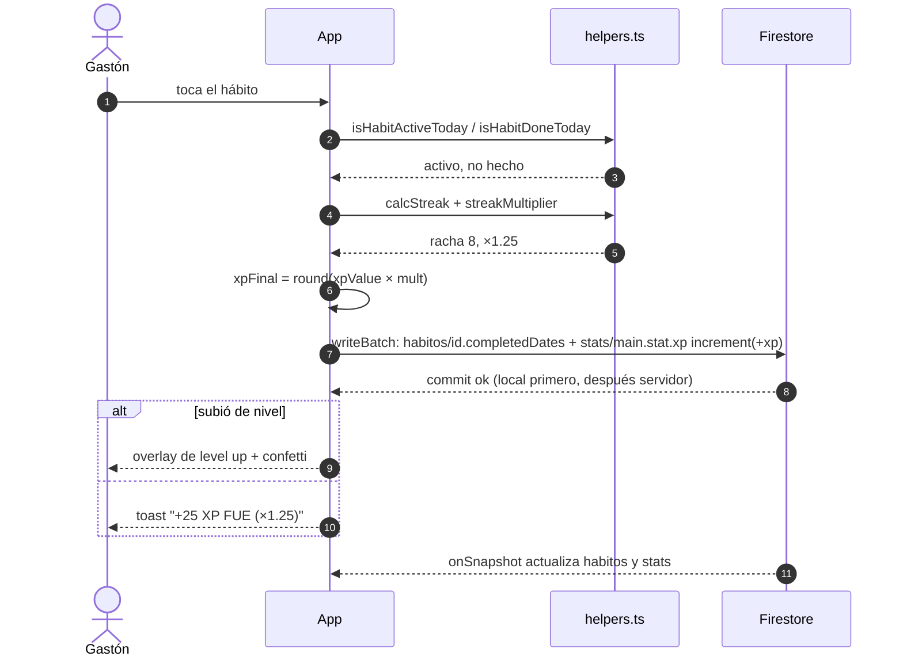
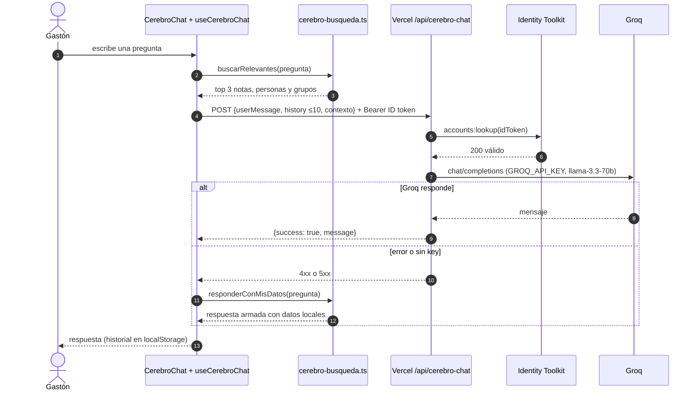
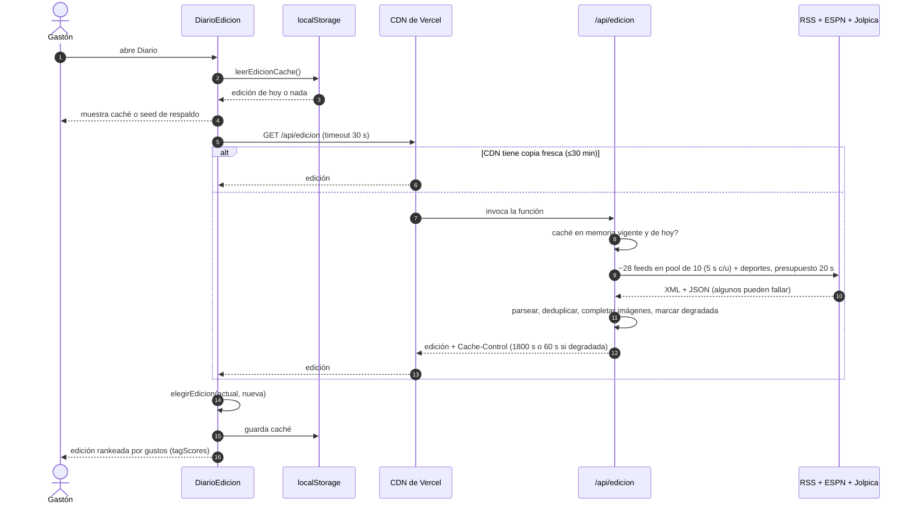
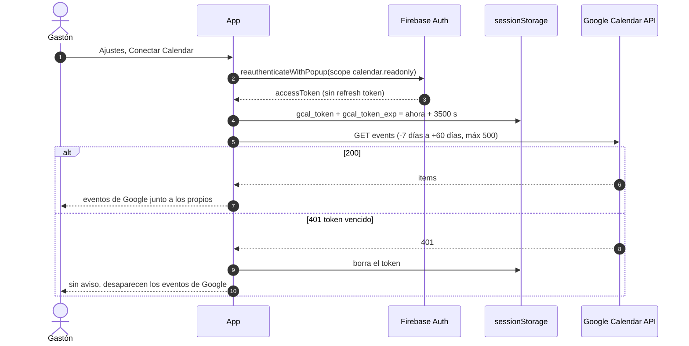
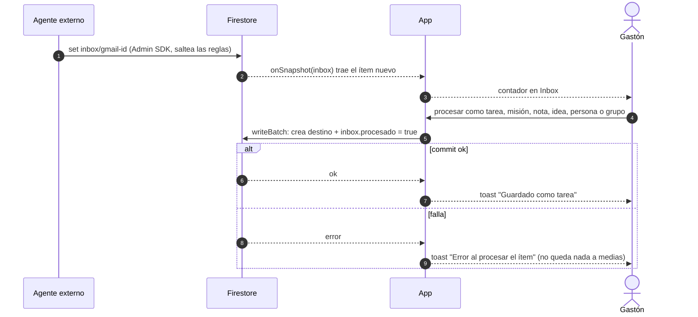

# Diagramas de secuencia

> Diagrama ④. Las 6 interacciones que cruzan una frontera de red. Cada una cita el código que la implementa.

## Hoy (as-is)

### 1. Login y carga de datos

Código: `front/src/App.tsx:260` (auth) y `App.tsx:302-339` (listeners).

### 2. Completar un hábito (XP atómico)

Código: `toggleHabit`, `App.tsx:585-623`.

### 3. Chat del Segundo Cerebro

Código: `hooks/useCerebroChat.ts:31-110`, `lib/cerebro-api.ts:20-41`, `api/cerebro-chat.ts:98-169`.

### 4. Edición diaria de La Gaceta

Código: `utils/edicion.ts:250-296` (cliente), `api/edicion.ts`, `server/diario/edicion.ts:132-216`.

### 5. Conectar Google Calendar

Código: `connectGCal`, `App.tsx:1784-1799` y el fetch en `App.tsx:280-299`.

### 6. Agente Gmail → Inbox → procesar

Código: `docs/INBOX_AGENTE.md` (contrato del agente) y `procesarInbox`, `App.tsx:1669-1726`.

## Objetivo (to-be)

Lo que cambia en cada secuencia:

| # | Cambio |
|---|---|
| 1 | Cada listener tiene callback de error → pantalla de error con "Reintentar". Los listeners se abren por feature, no todos al login. |
| 2 | El cálculo pasa a `CasoCompletarHabito` (ver [clases.md](clases.md)). La fecha sale de `hoyLocal()`, no de UTC. |
| 3 | El backend verifica que el token sea **del proyecto** (`aud`/`iss`) con firebase-admin, no solo que sea válido. Límite de pedidos por usuario. |
| 4 | Sin cambios de fondo. Mostrar "edición parcial" cuando `degradada` sea true. |
| 5 | Ante 401: avisar "Se venció la conexión con Calendar" con botón para reconectar. |
| 6 | El agente escribe con un esquema validado (mismo conversor que la app). |
