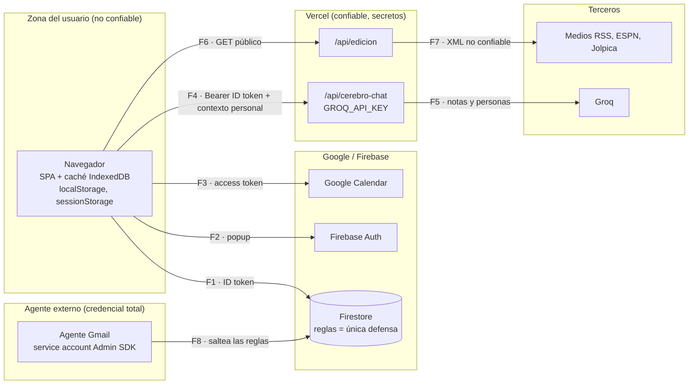

# Modelo de amenazas

> STRIDE liviano por frontera de confianza. Contexto clave: **el repo es público** (`docs/INBOX_AGENTE.md`), **cualquier cuenta de Google puede iniciar sesión** (Firebase Auth con Google no restringe quién entra), y **toda la base se lee y escribe desde el navegador**. La seguridad real depende de las reglas de Firestore.

## Fronteras de confianza

## Amenazas por frontera

Riesgo: **A** alto · **M** medio · **B** bajo.

| Flujo | STRIDE | Amenaza | Hoy | Riesgo | Control objetivo |
|---|---|---|---|---|---|
| F1 | Information disclosure / Tampering | Otro usuario autenticado lee o escribe `usuarios/{uid}` de Gastón | Depende de reglas que **no están en el repo** y no se pueden revisar | **A** | `firestore.rules` versionado con `request.auth.uid == uid` + tests ([firestore-rules.md](firestore-rules.md)) |
| F1 | Tampering | El propio cliente manda datos inválidos (XP negativo, tipos rotos) | Sin validación; casts `as FSHabito` | M | Validación de tipos y rangos en reglas + conversores |
| F1 | Elevation | Cualquier cuenta de Google crea usuario y usa la app | Login abierto | M | Lista de uids permitidos en reglas o bloquear sign-up en Auth (Identity Platform) |
| F2/F3 | Information disclosure | Robo del token de Calendar por XSS | Token en `sessionStorage` (`App.tsx:276`), scope solo lectura, ~1 h | B | CSP estricta; mantener scope `readonly` |
| F4 | Spoofing / DoS de costo | Cualquier cuenta de Google con ID token válido usa Groq y gasta la cuota | Desde P1: saca el uid del token, exige `ALLOWED_UIDS` (si está definida) y limita a 20 pedidos por minuto (`server/cerebro/limites.ts`) | M (hasta cargar `ALLOWED_UIDS` en Vercel) | Verificar con firebase-admin y exigir uid en `ALLOWED_UIDS`; límite de pedidos por minuto |
| F4 | Tampering | Body gigante | Historial recortado a 10 mensajes × 4000 caracteres (`api/cerebro-chat.ts:31-32`); `contexto` sin tope | M | Tope de tamaño del body completo (p. ej. 32 KB) |
| F5 | Information disclosure | Datos de terceros (notas de personas) salen a Groq | Por diseño, hasta 500/300 caracteres por ítem | M | Documentado en [privacidad.md](privacidad.md); opción para excluir personas |
| F5 | Tampering (prompt injection) | Un mail del inbox convertido en nota manipula la respuesta del chat | El LLM no tiene herramientas: solo puede responder texto | B | Mantener sin herramientas; marcar contenido externo en el prompt |
| F6/F7 | Tampering (XSS) | Título o bajada maliciosa de un feed | React escapa texto; links con `rel="noopener noreferrer"` | B | Validar `http(s)` en `normalizarItem` |
| F6 | DoS | Muchos pedidos fuerzan rearmar la edición | Caché en memoria + CDN `s-maxage=1800` (`api/edicion.ts:12-15`) | B | Suficiente |
| F8 | Elevation | Filtración de la service account del agente = acceso total a todos los usuarios | Documentado "nunca en un repo" (`INBOX_AGENTE.md`) | **A** | Service account con rol mínimo, rotación, y validar el esquema que escribe |
| F8 | Tampering | `url` maliciosa (`javascript:`) en un ítem del inbox | React 19 bloquea `javascript:` en `href`; `CerebroInbox.tsx:208` | B | Validar `http(s)` antes de renderizar |
| Repo | Information disclosure | Secretos commiteados | `.env` **no está** en `.gitignore` (solo `*.local`); `.env.local.example` pide `VITE_CLAUDE_API_KEY` (un `VITE_` termina en el bundle) | **A** | Agregar `.env` y `.env.*` (menos `.example`) al `.gitignore`; sacar `VITE_CLAUDE_API_KEY` del ejemplo |
| Notas | XSS | Markdown de notas con HTML | `renderMarkdown` escapa `& < >` antes de formatear (`utils/markdown.ts:7`); se usa con `dangerouslySetInnerHTML` en 3 lugares | B | Mantener el escape; si se agregan links, validar protocolo; test unitario de escape |
| Dispositivo | Information disclosure | Compu compartida: la caché IndexedDB y el historial del chat quedan al cerrar sesión | Desde P1 `cerrarSesion` borra la caché de Firestore, el historial del chat y las claves del día | B | `clearIndexedDbPersistence` + borrar claves locales al cerrar sesión |

## Lo que está bien hoy

- La key de Groq **nunca** llega al cliente (`lib/cerebro-api.ts:1-4`).
- Las escrituras que tocan XP son atómicas (`writeBatch` / `runTransaction`).
- El token de Calendar no sobrevive a la pestaña (`sessionStorage`).
- El markdown propio escapa HTML antes de formatear.

## Acciones

| Prioridad | Acción | Esfuerzo |
|---|---|---|
| **P0** | Revisar las reglas actuales en la consola de Firebase y copiarlas al repo (`firestore.rules`) | 15 min |
| **P0** | Agregar `.env` y `.env.*` al `.gitignore` (dejando `!.env.local.example`) | 2 min |
| **P0** | Sacar `VITE_CLAUDE_API_KEY` y `VITE_CLOUD_FUNCTION_URL` de `.env.local.example` | 2 min |
| P1 | `/api/cerebro-chat`: firebase-admin `verifyIdToken` + `ALLOWED_UIDS` + rate limit | 1 h |
| P1 | Reglas con validación de tipos para `stats`, `habitos`, `transacciones` + tests con emulador | 3 h |
| P1 | Limpiar caché local al cerrar sesión | 30 min |
| P2 | CSP en `vercel.json` (`default-src 'self'`, Google, Groq solo desde server) | 1 h |
| P2 | Validar `http(s)` en URLs del inbox y de los feeds | 30 min |
