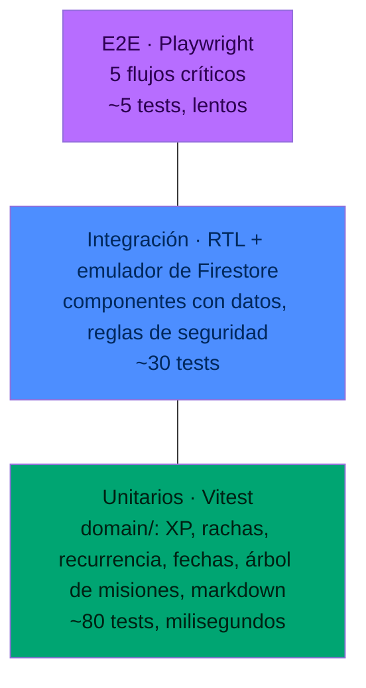

# Estrategia de pruebas

## Hoy (as-is)

- **0 tests.** No hay Vitest, Jest ni Playwright, ni archivos `*.test.*` / `*.spec.*`, ni script `test` en `package.json`.
- **0 CI.** No existe `.github/`.
- Lo único automático: `npm run lint` (24 errores hoy) y `tsc -b` dentro de `npm run build`.

## Objetivo (to-be)

### Pirámide



### Qué se testea en cada nivel

| Nivel | Herramienta | Qué cubre | Ejemplos |
|---|---|---|---|
| Unitario | Vitest | Funciones puras de `helpers.ts` (después `domain/`) | `xpLevel(0) = nivel 1`, `xpLevel(100) = nivel 2`, `xpLevel(300) = nivel 3`; `calcStreak` con huecos; `streakMultiplier(7) = 1.25`; `isHabitActiveToday` para `weekdays` en sábado; `buildTree` con huérfanas y prerequisitos; `renderMarkdown('<script>')` escapa |
| Unitario | Vitest | Lógica del Diario | `elegirEdicion`, `rankear`, `armarSeleccion` (`utils/edicion.ts`); `parsearFeed` con XML roto (`server/diario/xml.ts`) |
| Integración | React Testing Library | Componentes presentacionales con sus estados | `MissionNodeComp` bloqueada; `CierreDia` guarda solo si hay texto; `Modal` cierra con Escape (cuando exista) |
| Integración | `@firebase/rules-unit-testing` + emulador | Reglas de Firestore | los 11 casos de [firestore-rules.md](../05-seguridad/firestore-rules.md) |
| Integración | Vitest + mock de `fetch` | Funciones serverless | `/api/cerebro-chat`: 405, 401 sin token, 400 sin mensaje, 500 sin key, 502 si Groq falla |
| E2E | Playwright + emulador de Auth y Firestore | Flujos de usuario de punta a punta | ver abajo |

### Los 5 flujos E2E críticos

| # | Flujo | Pasos | Verifica |
|---|---|---|---|
| E1 | Login | entrar con usuario del emulador | llega al Dashboard; no queda el spinner |
| E2 | Completar hábito → XP | crear quest de Fuerza, marcarla | toast "+20 XP"; `stats/main.fuerza.xp` = 20; desmarcar vuelve a 0 |
| E3 | Misión con prerequisito | crear A y B (B requiere A), tocar B | B bloqueada con toast; completar A desbloquea B |
| E4 | Procesar inbox | crear ítem manual, procesar como tarea | aparece en Calendario hoy; el ítem queda procesado |
| E5 | Diario offline | abrir Diario con red, recargar sin red | muestra la caché y el aviso "Sin conexión" |

### Casos borde que tienen que tener test

Cada fila de [estados-y-excepciones.md](../02-ux/estados-y-excepciones.md) que se arregle entra con su test. Los primeros:

1. Fecha local después de las 21:00 (fijar `Date` con `vi.setSystemTime('2026-10-19T23:30:00-03:00')`).
2. Marcar y desmarcar con racha de 7: el XP vuelve exactamente al valor inicial.
3. Borrar misión prerequisito: la dependiente no queda bloqueada.
4. Listener con `permission-denied`: aparece el estado Error, no el spinner.

## Setup propuesto

Dependencias (fase P1 del [roadmap](../01-producto/roadmap.md)):

```bash
npm i -D vitest @vitest/coverage-v8 @testing-library/react @testing-library/user-event jsdom
```

```bash
npm i -D @playwright/test firebase-tools @firebase/rules-unit-testing
```

Scripts para `package.json`:

| Script | Comando |
|---|---|
| `test` | `vitest run` |
| `test:watch` | `vitest` |
| `test:cov` | `vitest run --coverage` |
| `test:rules` | `firebase emulators:exec --only firestore "vitest run tests/rules"` |
| `test:e2e` | `playwright test` |

Ubicación: tests unitarios al lado del archivo (`xp.test.ts` junto a `xp.ts`); reglas en `tests/rules/`; E2E en `tests/e2e/`.

## CI (cuando exista)

GitHub Actions en cada PR: `npm ci` → `lint` → `tsc` → `test:cov` → `test:rules` → `build`. E2E en el merge a `main` (más lento). Umbrales de [criterios-objetivos.md](criterios-objetivos.md).
