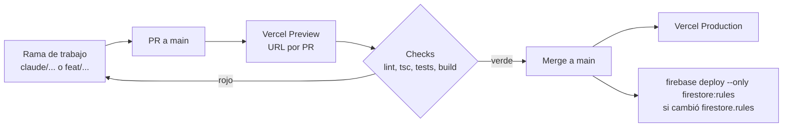

# Entornos y deploy

## Hoy (as-is)

### Entornos

| Entorno | Dónde | Cómo se levanta | `/api/edicion` | `/api/cerebro-chat` |
|---|---|---|---|---|
| Desarrollo | `http://localhost:5173` | `npm run dev` | ✅ middleware de `vite.config.ts` (`diarioApiDev`) | ❌ no existe en dev → el chat responde con búsqueda local |
| Preview | `npm run preview` (sirve `dist/`) | después de `npm run build` | ❌ | ❌ |
| Producción | `https://mi-app-estudio-gamma.vercel.app` (Vercel) | push a `main` (deploy automático de Vercel) | ✅ función serverless, `maxDuration: 30` (`vercel.json`) | ✅ función serverless |

`firebase.json` define hosting en Firebase (`dist/` con rewrite SPA), pero **producción corre en Vercel**. El bloque de hosting de Firebase no se usa.

### Variables de entorno

| Variable | Dónde se usa | ¿Llega al navegador? | Dónde se configura |
|---|---|---|---|
| `VITE_FIREBASE_API_KEY` | `lib/firebase.ts` y `api/cerebro-chat.ts:36` | Sí (normal: la config web de Firebase es pública) | `.env.local` y Vercel |
| `VITE_FIREBASE_AUTH_DOMAIN`, `_PROJECT_ID`, `_STORAGE_BUCKET`, `_MESSAGING_SENDER_ID`, `_APP_ID` | `lib/firebase.ts` | Sí (normal) | `.env.local` y Vercel |
| `GROQ_API_KEY` | `api/cerebro-chat.ts:120` | **No** (solo servidor) | Solo Vercel |
| `GROQ_MODEL` | `api/cerebro-chat.ts:138` (default `llama-3.3-70b-versatile`) | No | Vercel, opcional |
| ~~`VITE_CLAUDE_API_KEY`~~ | **nadie** (resto de la Cloud Function borrada en `6f4fa97`) | **Sí, si alguien la carga** | ⚠️ sacar de `.env.local.example` |
| ~~`VITE_CLOUD_FUNCTION_URL`~~ | nadie (`lib/cerebro-api.ts` usa `/api/cerebro-chat` fijo) | Sí | sacar |

**Regla:** todo lo que empieza con `VITE_` se mete en el bundle del navegador. Una key secreta **nunca** lleva ese prefijo.

### Problemas

1. `.env` **no** está en `.gitignore` (solo `*.local`). `git check-ignore .env` → no ignorado. Un `git add .` lo commitearía en un repo público.
2. `.env.local.example` pide `VITE_CLAUDE_API_KEY=sk-ant-xxx`: invita a poner una key secreta del lado del cliente.
3. El chat no se puede probar en dev.
4. `npm run build` falla si `node_modules` está desactualizado (falta `fast-xml-parser`): pasó en este worktree el 2026-10-19 hasta correr `npm install`.

## Objetivo (to-be)

### `.gitignore`

Agregar:

```gitignore
.env
.env.*
!.env.local.example
graphify-out/
```

### `.env.local.example`

```bash
# Config web de Firebase (es pública, va al navegador)
VITE_FIREBASE_API_KEY=
VITE_FIREBASE_AUTH_DOMAIN=
VITE_FIREBASE_PROJECT_ID=
VITE_FIREBASE_STORAGE_BUCKET=
VITE_FIREBASE_MESSAGING_SENDER_ID=
VITE_FIREBASE_APP_ID=

# Solo servidor (Vercel → Settings → Environment Variables). NUNCA con prefijo VITE_
# GROQ_API_KEY=
# GROQ_MODEL=llama-3.3-70b-versatile
```

### Chat en desarrollo

Opción recomendada: `vercel dev` (levanta las funciones de `api/` y Vite juntos). Alternativa: un segundo middleware en `vite.config.ts` como `diarioApiDev`, leyendo `GROQ_API_KEY` de `.env.local`.

### Flujo de deploy



Hoy existen los pasos A, B, E y F. El merge (E) lo hace el mismo agente que abrió el PR, cuando los checks pasan en local y el preview está *Ready* (ver [`CLAUDE.md`](../../CLAUDE.md#flujo-de-trabajo-todo-termina-en-main)). Los checks (D) llegan con la CI de [estrategia-pruebas.md](../06-calidad/estrategia-pruebas.md). El deploy de reglas (G) llega con [ADR-0006](../08-decisiones/ADR-0006-firestore-rules.md).

### Limpieza

- Sacar el bloque `hosting` de `firebase.json` o documentar que es un respaldo.
- Borrar las ramas viejas ya mergeadas (`git branch -a` muestra 9 locales y 14 remotas).
