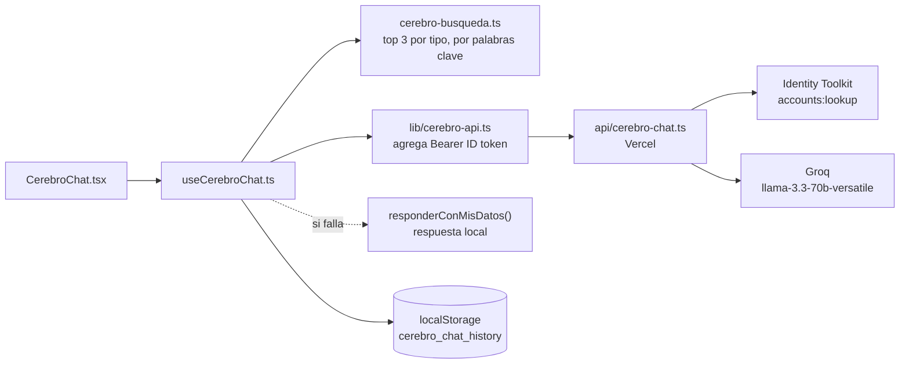

# Segundo Cerebro: chat con IA

> Reemplaza a `SEGUNDO_CEREBRO_SETUP.md` y `CEREBRO_QUICK_START.md`, que describían una Cloud Function de Firebase con la API de Claude. Esa función se borró en el commit `6f4fa97`; hoy el chat usa **Groq** desde una función de **Vercel**.

## Cómo funciona

| Pieza | Archivo | Qué hace |
|---|---|---|
| UI | `front/src/components/CerebroChat.tsx` | Burbujas, input, estado "pensando" |
| Hook | `front/src/hooks/useCerebroChat.ts` | Historial, contexto, fallback local |
| Búsqueda | `front/src/utils/cerebro-busqueda.ts` | Elige notas, personas y grupos relevantes |
| Cliente | `front/src/lib/cerebro-api.ts` | `POST /api/cerebro-chat` con el token de Firebase |
| Servidor | `api/cerebro-chat.ts` | Valida token, arma el prompt en rioplatense, llama a Groq (`temperature: 0.4`) |

Límites: 10 mensajes de historial, 4000 caracteres por mensaje (`api/cerebro-chat.ts:31-32`); notas recortadas a 500 caracteres y notas de personas/grupos a 300 en el prompt.

## Setup

1. Crear una key en [console.groq.com](https://console.groq.com) → API Keys.
2. Vercel → proyecto → Settings → Environment Variables → `GROQ_API_KEY` = la key (entornos Production y Preview). Opcional: `GROQ_MODEL`.
3. Verificar que `VITE_FIREBASE_API_KEY` también esté en Vercel (la función la usa para validar tokens).
4. **`ALLOWED_UIDS`** = tu uid de Firebase (Firebase Console → Authentication → Users → User UID). Sin esta variable el chat atiende a cualquier cuenta de Google con sesión.
5. Redeploy (Vercel → Deployments → Redeploy).
6. Probar: Segundo Cerebro → Chat → "¿Qué notas tengo sobre productividad?".

En `npm run dev` el chat **no** llega a Groq (no hay middleware): responde con búsqueda local. Para probarlo de verdad en local, ver [entornos-y-deploy.md](entornos-y-deploy.md#chat-en-desarrollo).

## Errores y qué significan

| Respuesta | Causa | Arreglo |
|---|---|---|
| 401 `Unauthorized` | No llegó el header `Authorization` | Volver a iniciar sesión |
| 401 `Invalid token` | Token vencido o de otro proyecto | Recargar la página |
| 403 `Este chat es privado` | El uid no está en `ALLOWED_UIDS` | Agregar el uid en Vercel |
| 429 `Demasiados pedidos seguidos` | Más de 20 pedidos por minuto (por instancia) | Esperar un minuto |
| 413 `El pedido es demasiado grande` | Body de más de 32 000 caracteres | Acortar el mensaje |
| 400 `userMessage is required` | Mensaje vacío | — |
| 500 `Falta GROQ_API_KEY en el servidor` | Variable no configurada | Paso 2 del setup |
| 500 `Falta VITE_FIREBASE_API_KEY en el servidor` | Variable no configurada en Vercel | Paso 3 |
| 502 | Groq respondió error o vacío | Ver [runbook](runbook.md#groq-caído-o-sin-key) |

En todos los casos el usuario igual recibe una respuesta armada con sus datos (`useCerebroChat.ts:78`).

## Próximos pasos (ideas de la versión vieja que siguen vigentes)

- Sincronizar el historial a Firestore (hoy solo en `localStorage`).
- Búsqueda semántica con embeddings en vez de palabras clave.
- Avisar en la UI cuando la respuesta es local y no de la IA.
- ✅ Hecho en P1: uids permitidos, 20 pedidos por minuto y tope de body (`server/cerebro/limites.ts`). El límite vive en memoria de cada instancia: es de mejor esfuerzo.
