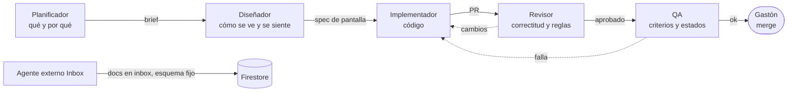

# Contrato de diseño entre agentes de IA

> **Todo agente de IA que toque este repo (Claude Code, Codex, Cursor, el agente del Inbox o cualquier otro) lee esta página antes de empezar.** Define quién hace qué, qué se entrega en cada paso y qué no se negocia. Si una regla de acá choca con un pedido de Gastón, gana Gastón, pero el agente avisa del choque.

## 1. Fuentes de verdad (en este orden)

| Tema | Fuente | Si no está ahí… |
|---|---|---|
| Qué hace la app y para quién | [01-producto/vision.md](01-producto/vision.md) | preguntar |
| Cómo se ve | [03-design-system/](03-design-system/) (tokens en [fundamentos.md](03-design-system/fundamentos.md), piezas en [componentes.md](03-design-system/componentes.md)) | se agrega primero al design system, después al código |
| Qué estados tiene cada pantalla | [02-ux/estados-y-excepciones.md](02-ux/estados-y-excepciones.md) | definir los 7 estados antes de codear |
| Cómo están los datos | [04-arquitectura/datos-er.md](04-arquitectura/datos-er.md) + `front/src/types.ts` | cambio de esquema = ADR |
| Qué está prohibido en seguridad | [05-seguridad/modelo-amenazas.md](05-seguridad/modelo-amenazas.md) | — |
| Cuándo algo está "terminado" | [06-calidad/criterios-objetivos.md](06-calidad/criterios-objetivos.md) + [criterios-aceptacion.md](06-calidad/criterios-aceptacion.md) | — |
| Por qué se decidió algo | [08-decisiones/](08-decisiones/) | escribir un ADR |
| Convenciones de código y comandos | [`CLAUDE.md`](../CLAUDE.md) | — |

## 2. Roles

Un mismo agente puede cumplir varios roles en una sesión, pero **cada rol entrega su artefacto** antes de pasar al siguiente.



| Rol | Lee | Entrega | No hace |
|---|---|---|---|
| **Planificador** | visión, roadmap, ADRs | brief (plantilla 4.1) | código |
| **Diseñador** | design system, estados, UX writing | spec de pantalla (plantilla 4.2): componentes del catálogo, los 7 estados, copy | inventar tokens o componentes sin agregarlos al catálogo |
| **Implementador** | spec, arquitectura, `CLAUDE.md` | PR chico con descripción (plantilla 4.3) | mezclar refactor y feature en el mismo PR |
| **Revisor** | PR, reglas de la sección 3 | aprobación o lista de cambios con `archivo:línea` | aprobar sin correr lint, tsc y build |
| **QA** | criterios de aceptación, matriz de estados | checklist marcada + evidencia (captura o test) | dar por bueno sin evidencia |
| **Agente externo (Inbox)** | [`docs/INBOX_AGENTE.md`](INBOX_AGENTE.md) | documentos en `usuarios/{uid}/inbox` con el esquema fijo | escribir en cualquier otra colección; mandar `null`; URLs que no sean `http(s)` |

## 3. Reglas no negociables

### Diseño

1. **Solo tokens semánticos.** Nada de hex sueltos, nada de `slate-*` / `blue-*` en código nuevo. Si falta un color, se agrega a `@theme` y a [fundamentos.md](03-design-system/fundamentos.md).
2. **Solo componentes del catálogo** (`ui/`). Un botón nuevo es `<Button variante=…>`, no un `<button className=…>` a mano.
3. **Los 7 estados** (cargando, vacío, error, offline, parcial, sin permiso, éxito) están definidos en la spec y en el código.
4. **Contraste medido**, no estimado: texto ≥ 4,5:1, bordes de controles y foco ≥ 3:1.
5. **Áreas táctiles ≥ 44 px**, foco visible, `prefers-reduced-motion` respetado.
6. **Copy en español rioplatense**, con el glosario de [ux-writing.md](02-ux/ux-writing.md). Cero textos en inglés en la UI.
7. **Sin emojis como íconos estructurales** (navegación, botones, estados).

### Código

1. TypeScript estricto, **sin `any`**. `import type` para tipos (`CLAUDE.md`).
2. Lógica de negocio (XP, rachas, fechas) en funciones puras con test, no dentro de componentes.
3. **Fecha "hoy" siempre local de Argentina** (cuando exista `hoyLocal()`), nunca `toISOString().slice(0, 10)`.
4. Cada `onSnapshot` con callback de error.
5. Escrituras que tocan más de un doc (XP + entidad) en `writeBatch` / `runTransaction`.
6. Borrar algo = limpiar sus referencias en el mismo batch.

### Seguridad

1. **Ningún secreto con prefijo `VITE_`.** Las keys de terceros viven solo en Vercel.
2. Nada de `.env` en commits.
3. Cambiar `firestore.rules` exige correr los tests del emulador.
4. HTML generado desde contenido del usuario o de terceros: escapado antes de `dangerouslySetInnerHTML`.

### Proceso

1. **PRs chicos:** un objetivo por PR. Mover código y cambiar comportamiento van en PRs separados.
2. Mensajes de commit en español informal ("Agrego X", "Corrijo Y"), sin prefijos (`CLAUDE.md`).
3. Antes de abrir el PR: `npm run lint`, `npx tsc -b`, `npm run build` (y `npm test` cuando exista). Pegar el resultado en la descripción.
4. Un PR que empeora un número de [criterios-objetivos.md](06-calidad/criterios-objetivos.md) explica por qué en la descripción.
5. Las decisiones que cambian arquitectura, esquema, estilo o dependencias grandes **llevan ADR** (sección 5).

## 4. Plantillas de handoff

### 4.1 Brief (Planificador → Diseñador)

```markdown
## Brief: <nombre>
- Problema: <qué le pasa a Gastón hoy, con evidencia archivo:línea>
- Objetivo: <qué tiene que poder hacer después>
- Casos de uso: <UC-x de casos-de-uso.md>
- Criterios de aceptación: <AC-x existentes o nuevos en Dado/Cuando/Entonces>
- Fuera de alcance: <lista>
- Riesgos: <datos, seguridad, rendimiento>
```

### 4.2 Spec de pantalla (Diseñador → Implementador)

```markdown
## Spec: <pantalla o componente>
- Layout móvil (375) y desktop (1440): <descripción o mockup>
- Componentes del catálogo: <Button primario "Crear quest", Card, …>
- Tokens nuevos: <ninguno | lista + PR al design system>
- Estados: cargando <…> · vacío <…> · error <…> · offline <…> · parcial <…> · sin permiso <…> · éxito <…>
- Copy: <todos los textos visibles>
- Movimiento: <entradas del catálogo de movimiento.md>
- Accesibilidad: <roles, labels, orden de foco>
```

### 4.3 Descripción de PR (Implementador → Revisor)

```markdown
## Qué cambia
<1–3 líneas>

## Por qué
<link al brief / issue / ADR>

## Cómo probarlo
1. <pasos>

## Checks
- [ ] npm run lint → 0 errores nuevos
- [ ] npx tsc -b → ok
- [ ] npm run build → ok (tamaño JS gzip: antes X KB, después Y KB)
- [ ] Los 7 estados de la spec
- [ ] Probado en 375 px y con teclado
```

## 5. Cuándo escribir un ADR

| Si el cambio… | ADR |
|---|---|
| agrega o saca una dependencia de más de 20 KB gzip | sí |
| cambia el esquema de Firestore o las reglas | sí |
| cambia un token, una fuente o un componente base del design system | sí |
| mueve responsabilidades entre capas (`domain/`, `data/`, `ui/`, `features/`) | sí |
| agrega un servicio externo (API, LLM, hosting) | sí |
| arregla un bug sin cambiar contratos | no |

Formato: [08-decisiones/plantilla.md](08-decisiones/plantilla.md).

## 6. Definition of Done

Una tarea está terminada cuando:

- [ ] Cumple sus criterios de aceptación (con evidencia).
- [ ] Tiene los 7 estados de pantalla, o justifica los que no aplican.
- [ ] Usa solo tokens y componentes del catálogo.
- [ ] Lint, tsc y build pasan; tests nuevos para la lógica nueva.
- [ ] No empeora ningún criterio objetivo sin explicarlo.
- [ ] Los docs afectados están actualizados (incluido "Hoy (as-is)" si cambió la realidad).
- [ ] Gastón la vio funcionando o la aprobó en el PR.
